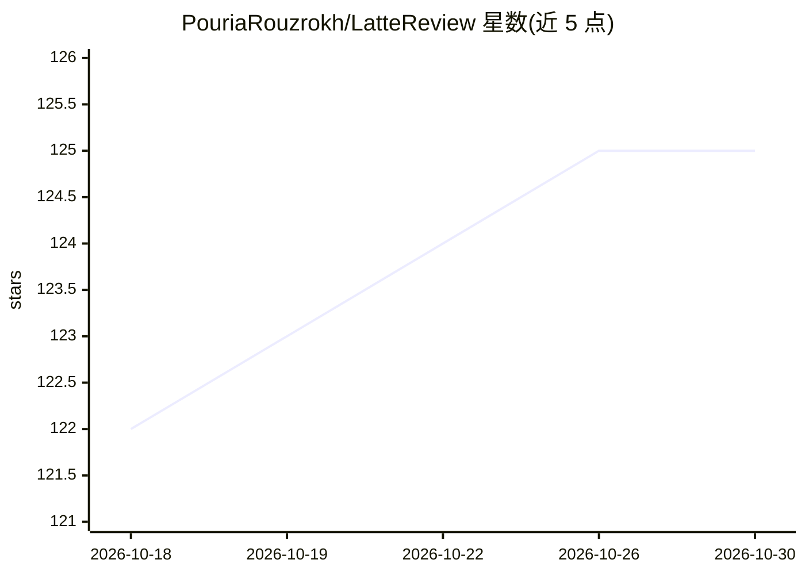

# PouriaRouzrokh/LatteReview

⭐ 125 · Jupyter Notebook · NOASSERTION · 推送 2026-10-17 · [GitHub](https://github.com/PouriaRouzrokh/LatteReview) · [官网](https://pouriarouzrokh.github.io/LatteReview) · 个人维护

**用多 AI agent 自动化系统性文献综述的 Python 库**

低代码 Python 包，通过多 agent 流水线自动化学术文献综述：可定义不同角色与专长的审稿 agent，串/并行组合成多轮审阅工作流，处理标题、摘要、自定义文本乃至图像；支持决策模型审稿人（pplx-decider、Jev、gpt-6-luna）返回概率做快速筛选，配合 LLM 审稿人混合工作。经 LiteLLM 接入 OpenAI/Claude/Gemini/Groq/DeepSeek/Perplexity/OpenRouter 及本地 Ollama，输出标准化评分与理由，含成本追踪；要求 Python 3.10+，采用 PolyForm 非商业许可。

## 筛选速览

| 维度 | 判定 | 备注 |
|---|---|---|
| AI 角色 | `ai-native` | 本体是模型或模型工具 |
| 许可风险 | `none` | NOASSERTION |
| 部署形态 | `library` | 以包/库形式分发 |
| 模型依赖 | local-ok | 支持本地模型 |
| 硬件要求 | — | 无带数字的原话,不猜 |
| 安装摩擦 | `low` | 无编译、无系统依赖或容器化 |
| 成熟度 | — | 结构信号不足 |

## 能力要点

- 多 agent 审阅工作流：可定义角色、专长、多轮与投票纠错
- 决策模型审稿人返回概率（pplx-decider/Jev/gpt-6-luna），支持按目标召回率拟合阈值
- 经 LiteLLM 兼容 OpenAI/Claude/Gemini/Groq/DeepSeek/Perplexity/OpenRouter，及 Ollama 本地模型
- 支持 RIS 文件格式与异步批量处理、成本追踪

## 适用场景

- 大规模标题/摘要筛选做系统性文献综述
- 决策模型快筛 + LLM 复核不确定文章的混合流程
- 数据抽取、图像分析等自定义审阅流水线

## 场景标签

`多智能体` `科研工具` · 领域:Agent 开发

## 证据(README 行号)

> L14: LatteReview is a powerful Python package designed to automate academic literature review processes through AI-power
> L60: - Multi-agent review system with customizable roles and expertise levels for each reviewer
> L86: LatteReview enables you to create custom literature review workflows with multiple AI reviewers. Each reviewer can 

## 星数曲线

2026-10-18 122 → 2026-10-30 125（+3）

---
*卡片 v1 · prompt 1.4 · 生成 2026-10-23 · 置信度 high · 依据 README sha `8fa35cd65b87` · [字段定义](../../DATASET.md)*
