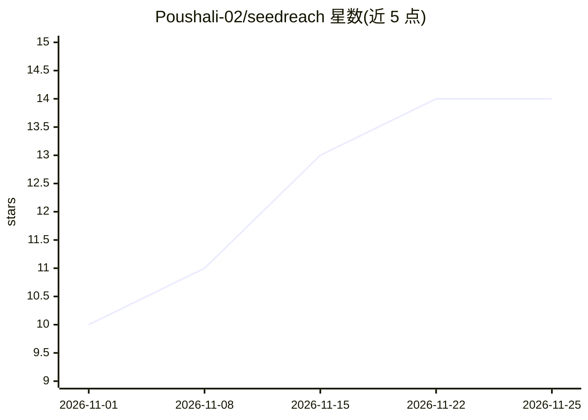

# Poushali-02/seedreach

⭐ 14 · Python · MIT · 推送 2026-11-20 · [GitHub](https://github.com/Poushali-02/seedreach) · 个人维护

**为求职者查找初创公司并生成个性化 cold email 草稿的 CLI**

一个 Python CLI：从 YC 目录、Hacker News、Product Hunt 等来源抓取正在招聘的早期初创公司，用 LLM 提取公司信息（Pydantic schema 约束 JSON 输出），查找创始人邮箱，并将个性化 cold email 保存到 Gmail 草稿箱供用户审阅后自行发送，工具本身只调用 drafts().create 从不发送。用户在 profile.json 中一次性描述自己，每封草稿自动匹配最相关项目。需要 Python 3.10+、Gmail 账号、Google Cloud 项目与 LLM API key；邮件仅纯文本，猜测的邮箱地址默认不入草稿。

## 筛选速览

| 维度 | 判定 | 备注 |
|---|---|---|
| AI 角色 | `ai-native` | 本体是模型或模型工具 |
| 许可风险 | `permissive` | MIT |
| 部署形态 | `library` | 以包/库形式分发 |
| 模型依赖 | locked-api |  |
| 硬件要求 | — | 无带数字的原话,不猜 |
| 安装摩擦 | `low` | 无编译、无系统依赖或容器化 |
| 成熟度 | `idea` | |

## 能力要点

- 多来源线索抓取：YC 目录、Launch HN、Ask HN 招聘帖、Product Hunt
- LLM 结构化提取公司信息，无效输出重试，繁忙错误退避重试
- 邮箱查找分级策略：Apollo 验证→站点创始人地址→格式猜测→通用收件箱，支持收件箱不入草稿
- 只写 Gmail 草稿从不发送，内置测试防止 send 调用

## 适用场景

- 找实习或初创早期岗位时批量生成个性化 cold email 草稿
- 从 YC 招聘公司与 HN 招聘帖中筛选早期小团队机会
- 按地区偏好排序求职线索并去重跟踪状态

## 场景标签

`网页抓取` `AI 写作` · 领域:效率与自动化

## 证据(README 行号)

> L16: A CLI that finds early-stage startups, reads their website with an LLM, finds a founder's email, and
> L26: sources (HN / Product Hunt / manual) -> scraper -> LLM extractor -> email finder
> L162: - **Extraction**: the LLM must return JSON matching a Pydantic schema (company, summary, domain, founder

## 星数曲线

2026-11-01 10 → 2026-11-25 14（+4）

---
*卡片 v1 · prompt 1.4 · 生成 2026-11-18 · 置信度 high · 依据 README sha `61d372621d55` · [字段定义](../../DATASET.md)*
