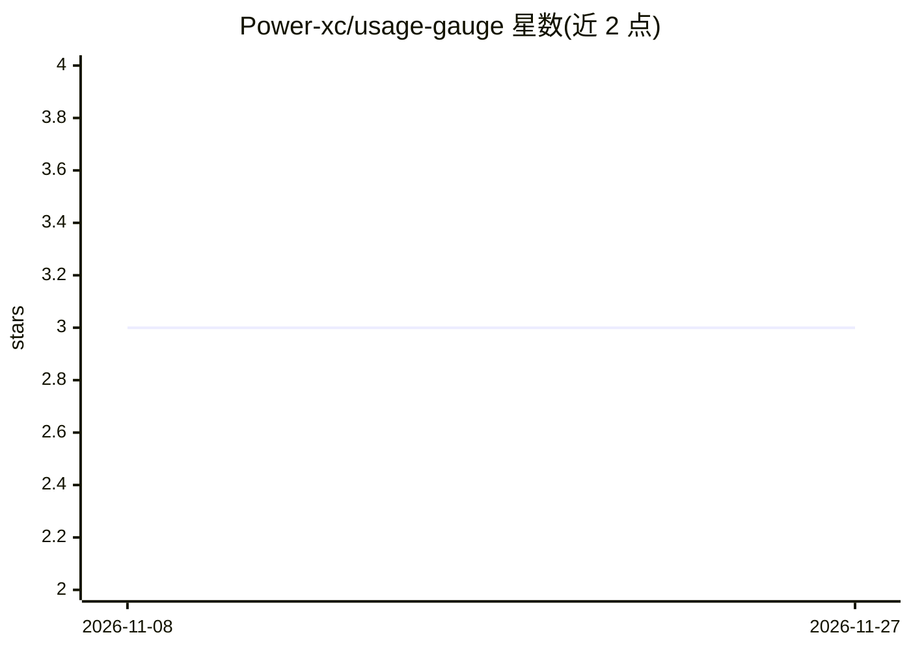

# Power-xc/usage-gauge

⭐ 3 · Swift · MIT · 推送 2026-11-02 · [GitHub](https://github.com/Power-xc/usage-gauge) · 个人维护

**macOS/Windows 浮动仪表：集中显示各 AI 服务剩余用量与耗尽时间**

一款桌面浮动面板与菜单栏工具，聚合 Claude、Codex、Gemini、Cursor、Copilot 等 100 余个 AI 服务的剩余用量，按最近 1 小时消耗速度计算预计耗尽时间与重置时刻。提供 12 种图形与 3 种外观样式，支持悬停查看详情、大小与透明度调节，数据每 2 分钟刷新且仅存本地。macOS 需先安装使用量 CLI，Windows 版直接读取 Claude Code 与 Codex CLI 登录文件。

## 筛选速览

| 维度 | 判定 | 备注 |
|---|---|---|
| AI 角色 | `ai-ecosystem` | LLM/agent 周边工具 |
| 许可风险 | `permissive` | MIT |
| 部署形态 | `desktop` | 安装包/桌面程序 |
| 模型依赖 | — | README 未给出锁定关系 |
| 硬件要求 | — | 无带数字的原话,不猜 |
| 安装摩擦 | `medium` | 含编译或系统依赖之一 |
| 成熟度 | — | 结构信号不足 |

## 能力要点

- 聚合 100 余个 AI 服务的剩余用量到单一面板与菜单栏
- 按最近 1 小时用量计算预计耗尽时间与重置时刻
- 12 种图形样式与 3 种外观，尺寸 0.7–1.6 倍、透明度 30–100% 可调
- 不申请屏幕录制等权限，macOS 版不读取或存储账户 token

## 适用场景

- 多服务重度使用时集中查看各 AI 剩余额度
- 预测当前用量何时耗尽以安排任务
- 菜单栏常驻监控周/月窗口剩余百分比

## 场景标签

 · 领域:开发者工具/AI 用量监控

## 证据(README 行号)

> L5: **쓰는 모든 AI의 남은 한도를, 언제 바닥나는지까지.**
> L7: Claude · Codex · Gemini · Cursor · Copilot … 남은 사용량을 화면 위 게이지와 메뉴바에 띄웁니다.
> L22: - **모든 AI를 한 패널에** — Claude · Codex · Gemini · Cursor · Copilot · Windsurf · Grok · OpenRouter 등 100여 개 서비스 중 켜 둔 것

## 星数曲线

2026-11-08 3 → 2026-11-27 3（+0）

---
*卡片 v1 · prompt 1.4 · 生成 2026-11-22 · 置信度 high · 依据 README sha `8f025a68da8c` · [字段定义](../../DATASET.md)*
