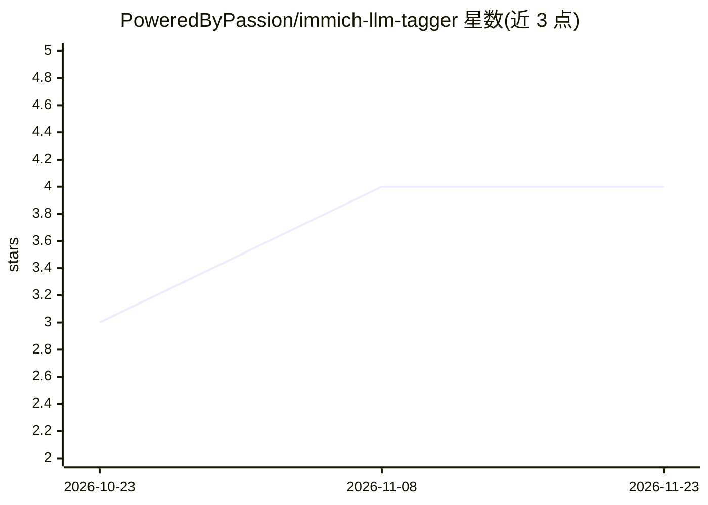

# PoweredByPassion/immich-llm-tagger

⭐ 4 · Python · MIT · 推送 2026-10-21 · [GitHub](https://github.com/PoweredByPassion/immich-llm-tagger) · 个人维护 · 中文 README

**自托管 Immich 用户的照片自动分类与打标服务**

面向自托管 Immich 实例的自动化服务：调用视觉多模态模型对照片分类，将截图/表情包/广告等杂项移入 Immich 归档，把发票与证件归入对应相册，并可为敏感内容打标。触发方式支持 Immich Webhook 实时通知与定时轮询；所有操作记录审计日志并可一键回滚；可同时写入星级评分与描述，且不覆盖用户手写内容。提供 Web 管理界面、中英文规则模板，经 Docker Compose 部署。

## 筛选速览

| 维度 | 判定 | 备注 |
|---|---|---|
| AI 角色 | `ai-native` | 本体是模型或模型工具 |
| 许可风险 | `permissive` | MIT |
| 部署形态 | `self-host` | docker 或自建部署 |
| 模型依赖 | local-ok | 支持本地模型 |
| 硬件要求 | — | 无带数字的原话,不猜 |
| 安装摩擦 | `low` | 无编译、无系统依赖或容器化 |
| 成熟度 | — | 结构信号不足 |

## 能力要点

- 兼容任意 OpenAI 兼容 Vision API 端点（DeepSeek-VL、Qwen2.5-VL、GPT-4o、Claude、本地 Ollama）
- Webhook 实时触发与轮询兜底的双触发架构
- change_log 审计日志支持一键回滚，操作可逆
- 中英文标准标签规则模板可一键导入

## 适用场景

- 清理手机备份后时间线里的截图与杂图
- 把发票、证件扫描件自动归档到专用相册
- 给证件、密码截图等敏感内容自动打标
- 让模型为照片写星级评分和描述，同时保护手写信息

## 场景标签

`多模态` · 领域:感知与多模态

## 证据(README 行号)

> L18: **Immich LLM Tagger** is a self-hosted, lightweight automation service designed specifically for Immich. It uses mu
> L20: 1. **Auto-archive junk**: Move screenshots, memes, and throwaway graphics out of your main timeline into Immich Arc

## 星数曲线

2026-10-23 3 → 2026-11-23 4（+1）

---
*卡片 v1 · prompt 1.4 · 生成 2026-11-21 · 置信度 high · 依据 README sha `f44165422659` · [字段定义](../../DATASET.md)*
