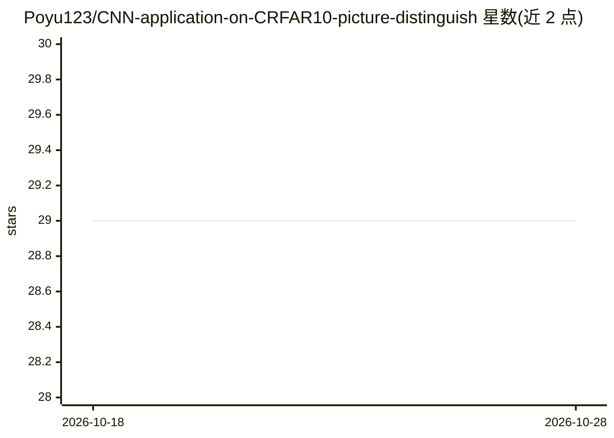

# Poyu123/CNN-application-on-CRFAR10-picture-distinguish

⭐ 29 · Python · 推送 2026-03-20 · [GitHub](https://github.com/Poyu123/CNN-application-on-CRFAR10-picture-distinguish) · 个人维护 · 中文 README

**TensorFlow/Keras 的 CIFAR-10 图像分类课程项目：训练 CNN 识别 10 类物体**

基于卷积神经网络的图像分类系统，对 CIFAR-10 数据集的 10 类目标（飞机、汽车、鸟、猫等）进行识别与区分，最初为线性代数课程项目设计。提供数据预处理脚本（二进制转 .jpg）、标准 CNN 训练与自动化超参数调优两种训练模式，训练后保存 .h5 模型及 Loss/Accuracy 曲线；支持用互联网任意图片或内部测试集验证，输出概率分布图与准确率图表。运行前需手动修改各脚本中的 base_dir 全局变量为本地绝对路径。

## 筛选速览

| 维度 | 判定 | 备注 |
|---|---|---|
| AI 角色 | `ai-native` | 本体是模型或模型工具 |
| 许可风险 | `none` | — |
| 部署形态 | `None` |  |
| 模型依赖 | — | README 未给出锁定关系 |
| 硬件要求 | — | 无带数字的原话,不猜 |
| 安装摩擦 | `low` | 无编译、无系统依赖或容器化 |
| 成熟度 | — | 结构信号不足 |

## 能力要点

- 标准 CNN 训练与自动化超参数调优（auto_main.py）两种模式
- CIFAR-10 二进制数据自动转换为按类别组织的 .jpg 图像
- 训练自动保存 .h5 模型与 Loss/Accuracy 曲线图
- 支持任意互联网图片预测与测试集随机抽样验证，输出概率分布图

## 适用场景

- 我想跑一个 CNN 入门项目学习图像分类流程
- 课程项目中演示 CIFAR-10 十类物体的识别
- 训练后用自己下载的图片测试模型预测效果

## 场景标签

`目标检测` · 领域:感知与多模态

## 证据(README 行号)

> L4: This project is an image classification system based on a Convolutional Neural Network (CNN), designed to effectivel
> L28: * **Regular Training**: Run `code/main.py`. This script contains a standard CNN architecture. After training, it wi

## 星数曲线

2026-10-18 29 → 2026-10-28 29（+0）

---
*卡片 v1 · prompt 1.4 · 生成 2026-10-26 · 置信度 high · 依据 README sha `42aada36fab1` · [字段定义](../../DATASET.md)*
