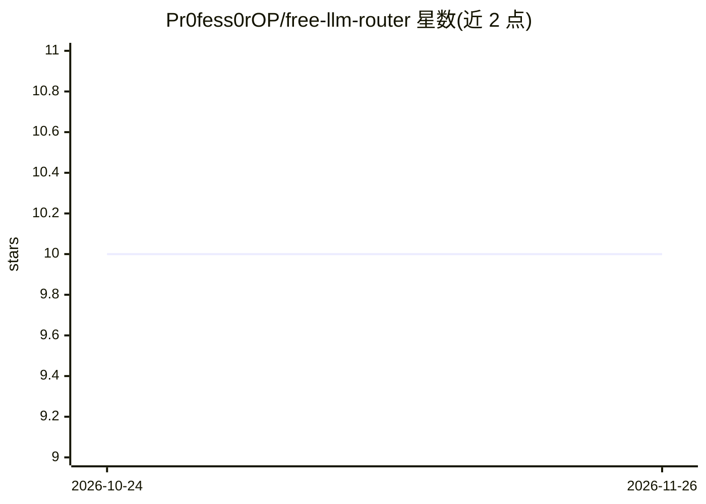

# Pr0fess0rOP/free-llm-router

⭐ 10 · TypeScript · MIT · 推送 2026-11-25 · [GitHub](https://github.com/Pr0fess0rOP/free-llm-router) · [官网](https://llmrouter.dpdns.org/) · 个人维护

**自托管 BYOK LLM API 网关：多提供商路由与故障转移**

开源、自托管的 LLM API 路由网关：用户自带各云服务 API key，通过一个 OpenAI 兼容端点接入应用，由路由器按能力、策略、配额、健康度选择可用模型，并提供自动故障转移、熔断器、限流冷却、请求去重、模型别名与用量分析。附带自托管仪表盘（Clerk 登录），可经回环 agent 与 ngrok 隧道配对 Ollama 或 LM Studio 本地节点。需 Node.js 20+、Git 与 Clerk 账户，MIT 许可。

## 筛选速览

| 维度 | 判定 | 备注 |
|---|---|---|
| AI 角色 | `ai-ecosystem` | LLM/agent 周边工具 |
| 许可风险 | `permissive` | MIT |
| 部署形态 | `library` | 以包/库形式分发 |
| 模型依赖 | local-ok | 支持本地模型 |
| 硬件要求 | — | 无带数字的原话,不猜 |
| 安装摩擦 | `low` | 无编译、无系统依赖或容器化 |
| 成熟度 | — | 结构信号不足 |

## 能力要点

- OpenAI 兼容端点，支持 OpenAI Chat Completions、Responses/Codex 与 Claude Code 网关
- 自动故障转移、熔断器与限流/配额保护（遵循 Retry-After）
- 模型别名与能力匹配，请求去重合并
- 配对 Ollama/LM Studio 私有本地节点，仪表盘管理与分析

## 适用场景

- 用一把 flm_ 主钥统一接入多个 LLM 云服务
- 某家服务限流或故障时自动切换到备用提供商
- 管理免费额度用量，避免意外扣费
- 把本地 Ollama/LM Studio 节点纳入统一路由

## 场景标签

`模型网关` · 领域:Agent 开发

## 证据(README 行号)

> L7: Bring your own LLM API keys and route **OpenAI Chat Completions**, **OpenAI Responses/Codex**, and **Claude Code** t
> L24: 4. **Your apps talk to the router** — Instead of your app talking directly to each AI service, it talks to this rou

## 星数曲线

2026-10-24 10 → 2026-11-26 10（+0）

---
*卡片 v1 · prompt 1.4 · 生成 2026-11-20 · 置信度 high · 依据 README sha `dd2958bf7b76` · [字段定义](../../DATASET.md)*
