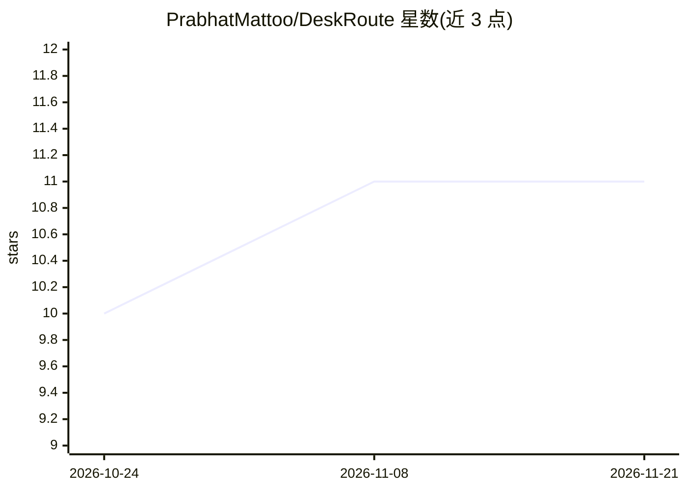

# PrabhatMattoo/DeskRoute

⭐ 11 · TypeScript · AGPL-3.0 · 推送 2026-09-18 · [GitHub](https://github.com/PrabhatMattoo/DeskRoute) · 个人维护

**给预约类本地商家的自托管 AI 电话接待员**

面向预约型本地商家的自托管开源 AI 接待员：真实电话号码接入（LiveKit Phone Numbers），语音通话中由 agent 根据配置的服务、价格、营业时间与知识库作答，并直接将预约写入 Google Calendar；无法回答的问题进入管理后台的升级队列，回答后自动沉淀为知识库问答对。技术栈为 Hono + Postgres/Drizzle、React 前端、LiveKit Agents SDK 语音管线，支持一次部署服务多个商家。需自备 LiveKit Cloud 项目与美国电话号码及 Clerk 账号。

## 筛选速览

| 维度 | 判定 | 备注 |
|---|---|---|
| AI 角色 | `ai-native` | 本体是模型或模型工具 |
| 许可风险 | `viral` | AGPL-3.0 |
| 部署形态 | `self-host` | docker 或自建部署 |
| 模型依赖 | locked-api |  |
| 硬件要求 | — | 无带数字的原话,不猜 |
| 安装摩擦 | `low` | 无编译、无系统依赖或容器化 |
| 成熟度 | — | 结构信号不足 |

## 能力要点

- 通过 LiveKit 接听真实电话并语音完成 Google Calendar 预约
- 知识库随升级解答自动增长，业务信息直接烘焙进系统提示
- 每次通话强制播放 AI 身份披露（美国多州法律要求）
- 带管理后台：通话记录、升级队列、预约视图、浏览器内实时测试

## 适用场景

- 让 AI 代接沙龙/门店的预约电话并自动写日历
- AI 答不了的来电问题转给店员处理后自动入知识库
- 一个部署同时服务多家门店或多条业务线

## 场景标签

`语音 Agent` · 领域:对话与助手

## 证据(README 行号)

> L3: DeskRoute is an AI receptionist for appointment-based local businesses. A customer rings a real US phone number, Des
> L61: |Voice pipeline|LiveKit Agents SDK|
> L63: |LLM|LiveKit Inference by default; OpenRouter via `LLM_PROVIDER`|

## 星数曲线

2026-10-24 10 → 2026-11-21 11（+1）

---
*卡片 v1 · prompt 1.4 · 生成 2026-11-18 · 置信度 high · 依据 README sha `a3df0393ae56` · [字段定义](../../DATASET.md)*
