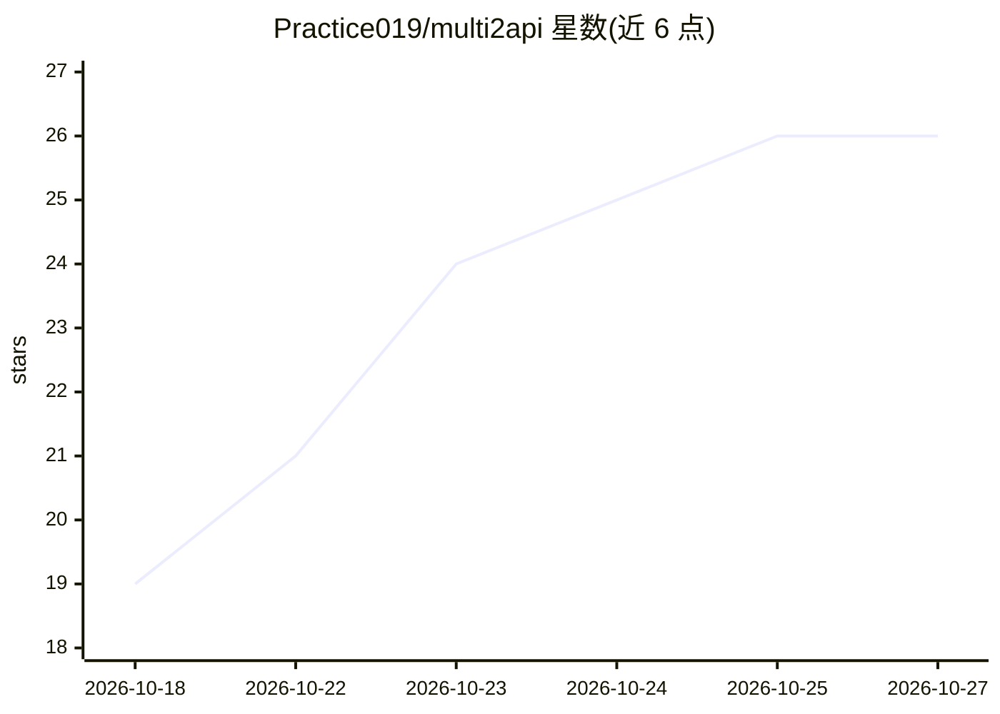

# Practice019/multi2api

⭐ 26 · Go · MIT · 推送 2026-10-26 · [GitHub](https://github.com/Practice019/multi2api) · 个人维护 · 中文 README

**聚合 13 个 AI 上游账号为 OpenAI 兼容 API 的网关**

Go 编写的多上游聚合反向代理网关：把腾讯 CodeBuddy/WorkBuddy、CodeArts、TRAE、MiniMax Code 等 13 个上游账号聚合为一个 OpenAI 兼容的 base_url + api_key，提供流式/非流式对话、生图、模型列表端点。账号池支持健康检查、熔断冷却、按权重选号与会话粘性，并自动执行签到、保活与凭证续期；Anthropic 协议上游经共享转换层转为 OpenAI 形态。自带 /ui 管理控制台（单管理员模式、限速与人机校验）。通过 Releases 预编译二进制或 go build 安装，本地运行，反向代理各上游账号。

## 筛选速览

| 维度 | 判定 | 备注 |
|---|---|---|
| AI 角色 | `ai-ecosystem` | LLM/agent 周边工具 |
| 许可风险 | `permissive` | MIT |
| 部署形态 | `None` |  |
| 模型依赖 | — | README 未给出锁定关系 |
| 硬件要求 | — | 无带数字的原话,不猜 |
| 安装摩擦 | `medium` | 含编译或系统依赖之一 |
| 成熟度 | — | 结构信号不足 |

## 能力要点

- 13 个上游账号聚合为单一 OpenAI 兼容 API
- 账号池状态机：健康/冷却/熔断/禁用，按权重选号，主动健康检查自愈
- 定时签到、保活、额度刷新与凭证续期由上游自报清单生成
- /ui 管理控制台：仪表盘/账号池/请求日志，单管理员模式含限速与人机校验
- 上游工具（生图/联网搜索）注入并由网关侧执行，agent 框架零配置可用

## 适用场景

- 把多个 AI 编程助手账号统一成一个 OpenAI 兼容接口给我的应用调用
- 多账号轮转与自动签到保活，避免手动维护额度
- 在 Claude Code、Cursor 等 agent 框架里零配置使用网关注入的生图与搜索工具
- 自托管部署并通过管理控制台观察请求日志与账号状态

## 场景标签

`模型网关` · 领域:Agent 开发

## 证据(README 行号)

> L5:  把 13 个 AI 上游聚合成 OpenAI 兼容 API 的多账号网关
> L10: **multi2api 是一个多上游聚合反代网关**：把多个上游账号聚合成一个 OpenAI 兼容的
> L11: `base_url` + `api_key`。你的应用只认 OpenAI 协议，网关负责背后的上游选号、额度、

## 星数曲线

2026-10-18 19 → 2026-10-27 26（+7）

---
*卡片 v1 · prompt 1.4 · 生成 2026-10-26 · 置信度 high · 依据 README sha `604181f11042` · [字段定义](../../DATASET.md)*
