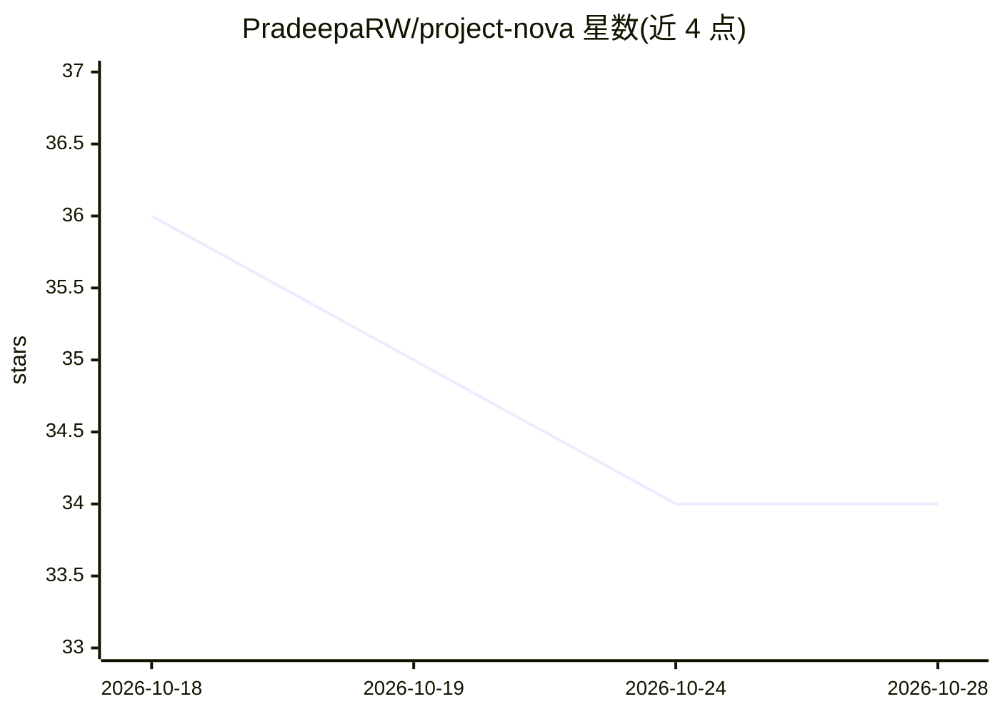

# PradeepaRW/project-nova

⭐ 34 · Shell · 推送 2026-10-12 · [GitHub](https://github.com/PradeepaRW/project-nova) · 个人维护

**连接 25+ 专业 agent 的多智能体架构，基于 n8n 与 MCP**

多智能体 AI 架构仓库：通过 n8n 工作流引擎与 MCP 服务器连接 25 个以上按领域分工的 agent，将请求路由到对应专家，实现对知识库、DAW、家庭自动化和开发工具等应用的控制。仓库内容包含各 agent 的系统提示词、Dockerfile 与预置工作流，通过 git clone 与 docker-compose 部署，浏览器访问 localhost:3000 使用界面或 API 交互。MIT 许可。

## 筛选速览

| 维度 | 判定 | 备注 |
|---|---|---|
| AI 角色 | `ai-ecosystem` | LLM/agent 周边工具 |
| 许可风险 | `none` | — |
| 部署形态 | `self-host` | docker 或自建部署 |
| 模型依赖 | — | README 未给出锁定关系 |
| 硬件要求 | — | 无带数字的原话,不猜 |
| 安装摩擦 | `low` | 无编译、无系统依赖或容器化 |
| 成熟度 | — | 结构信号不足 |

## 能力要点

- 25+ 领域专用 agent，请求按领域路由
- 基于 n8n（工作流）与 MCP（外部应用通信）的架构
- 包含系统提示词、Dockerfile 与可自定义的预置工作流

## 适用场景

- 搭建跨领域的多智能体助手系统
- 用自然语言请求控制知识库、DAW、智能家居等应用
- 作为 n8n + MCP 多 agent 方案的参考实现

## 场景标签

`多智能体` `AI 助手` · 领域:Agent 开发

## 证据(README 行号)

> L5: Welcome to **Project NOVA**! This repository hosts a multi-agent AI architecture designed to connect over 25 special
> L26: - **n8n Server**: Acts as the workflow automation tool, connecting agents and managing requests.
> L27: - **MCP Server**: Handles communication between agents and external applications.

## 星数曲线

2026-10-18 36 → 2026-10-28 34（-2）

---
*卡片 v1 · prompt 1.4 · 生成 2026-10-25 · 置信度 high · 依据 README sha `a8382f9bb4cd` · [字段定义](../../DATASET.md)*
