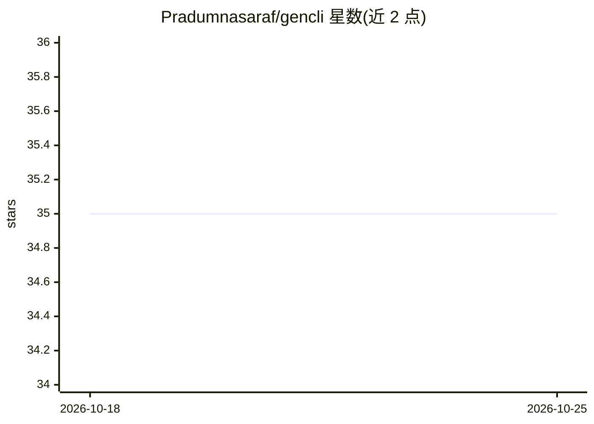

# Pradumnasaraf/gencli

⭐ 35 · Go · Apache-2.0 · 推送 2026-10-23 · [GitHub](https://github.com/Pradumnasaraf/gencli) · [官网](https://pkg.go.dev/github.com/Pradumnasaraf/gencli) · 个人维护

**Go 编写的命令行工具：调用 Google Gemini API 回答问题与分析图片**

基于 Golang（Cobra 与 Viper 库）构建的 AI CLI 工具，通过 Google Gemini API 提供问答搜索与图片分析功能。支持动态选择 GenAI 模型、设置输出语言与温度参数，可用单条命令自更新到最新版本。安装方式为 go install，需在环境变量中设置 GOOGLE_API_KEY（可在 Google AI Studio 免费获取）；CLI 配置存储于 ~/.gencli 目录。采用 Apache-2.0 许可证。

## 筛选速览

| 维度 | 判定 | 备注 |
|---|---|---|
| AI 角色 | `ai-native` | 本体是模型或模型工具 |
| 许可风险 | `permissive` | Apache-2.0 |
| 部署形态 | `library` | 以包/库形式分发 |
| 模型依赖 | — | README 未给出锁定关系 |
| 硬件要求 | — | 无带数字的原话,不猜 |
| 安装摩擦 | `low` | 无编译、无系统依赖或容器化 |
| 成熟度 | — | 结构信号不足 |

## 能力要点

- 通过 Google Gemini API 回答问题与图片分析
- 动态选择 GenAI 模型，可设置输出语言与温度
- 单命令自更新到最新版本

## 适用场景

- 在终端中直接向 Gemini 提问获取回答
- 通过命令行分析图片内容
- 设置偏好语言获取响应

## 场景标签

`AI 助手` · 领域:对话与助手

## 证据(README 行号)

> L5: **GenCLI** is an AI-powered CLI tool built with Golang that answers your questions using the Google Gemini API. It i
> L12: - **Image Analysis**: Get details about an image.

## 星数曲线

2026-10-18 35 → 2026-10-25 35（+0）

---
*卡片 v1 · prompt 1.4 · 生成 2026-10-25 · 置信度 high · 依据 README sha `073cbe04e341` · [字段定义](../../DATASET.md)*
