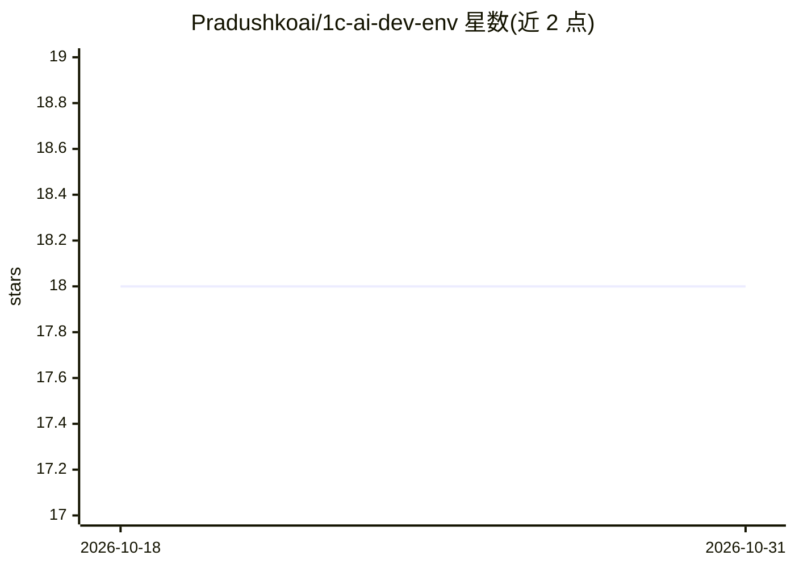

# Pradushkoai/1c-ai-dev-env

⭐ 18 · 1C Enterprise · MIT · 推送 2026-09-01 · [GitHub](https://github.com/Pradushkoai/1c-ai-dev-env) · [官网](https://github.com/Pradushkoai/1c-ai-dev-env/releases/tag/data-package) · 个人维护

**1С 开发环境：BSL 代码分析、元数据解析与 MCP 服务器供 AI 使用**

面向 1С 平台开发者的工具集与 CLI：11 个 BSL 代码分析器（150+ 规则）、解析 35 类 1С 元数据对象、5 个 JSON DSL→XML 编译器（元数据/表单/СКД/макет/角色）、CFE 扩展操作、依赖图、BM25 平台方法检索，以及可在不安装 1С 的情况下生成 .epf 外部处理文件。内置 MCP 服务器（10 tools）供 Cursor / Claude Desktop / VS Code / JetBrains 接入，并带 AGENTS.md 规则文件供 AI 代理阅读。项目自述为 Beta 状态，各子系统标注了 Stable/Beta/Experimental/Frozen 分级；RAG 与 Ollama 为实验性可选特性。

## 筛选速览

| 维度 | 判定 | 备注 |
|---|---|---|
| AI 角色 | `ai-ecosystem` | LLM/agent 周边工具 |
| 许可风险 | `permissive` | MIT |
| 部署形态 | `self-host` | docker 或自建部署 |
| 模型依赖 | — | README 未给出锁定关系 |
| 硬件要求 | — | 无带数字的原话,不猜 |
| 安装摩擦 | `low` | 无编译、无系统依赖或容器化 |
| 成熟度 | `idea` | |

## 能力要点

- 11 个 BSL 分析器（150+ 规则）含安全审计与 SARIF 输出
- MCP 服务器 10 tools，接入 Cursor/Claude Desktop/VS Code/JetBrains
- 5 个 JSON DSL→XML 编译器，覆盖 23 类元数据对象
- 无需安装 1С 即可创建 .epf 外部处理（v8unpack 模板 + BSL LS 校验）

## 适用场景

- 在 IDE 中通过 AI 代理分析 1С 配置的 BSL 代码与元数据
- 用 JSON DSL 生成 1С 元数据、表单、СКД、打印 макет 与角色 XML
- 对 1С 扩展（CFE）做借用、拦截补丁与差异分析
- 将代码检查结果以 SARIF 输出到 GitHub Code Scanning

## 场景标签

 · 领域:1С 企业开发工具

## 证据(README 行号)

> L289: Проект включает собственный MCP-сервер с 10 tools для Cursor / Claude Desktop / VS Code / JetBrains.
> L1: # 1C AI Development Environment
> L100: > Проект в статусе **Beta** (см. ROADMAP.md).

## 星数曲线

2026-10-18 18 → 2026-10-31 18（+0）

---
*卡片 v1 · prompt 1.4 · 生成 2026-10-30 · 置信度 high · 依据 README sha `05b2c886f161` · [字段定义](../../DATASET.md)*
