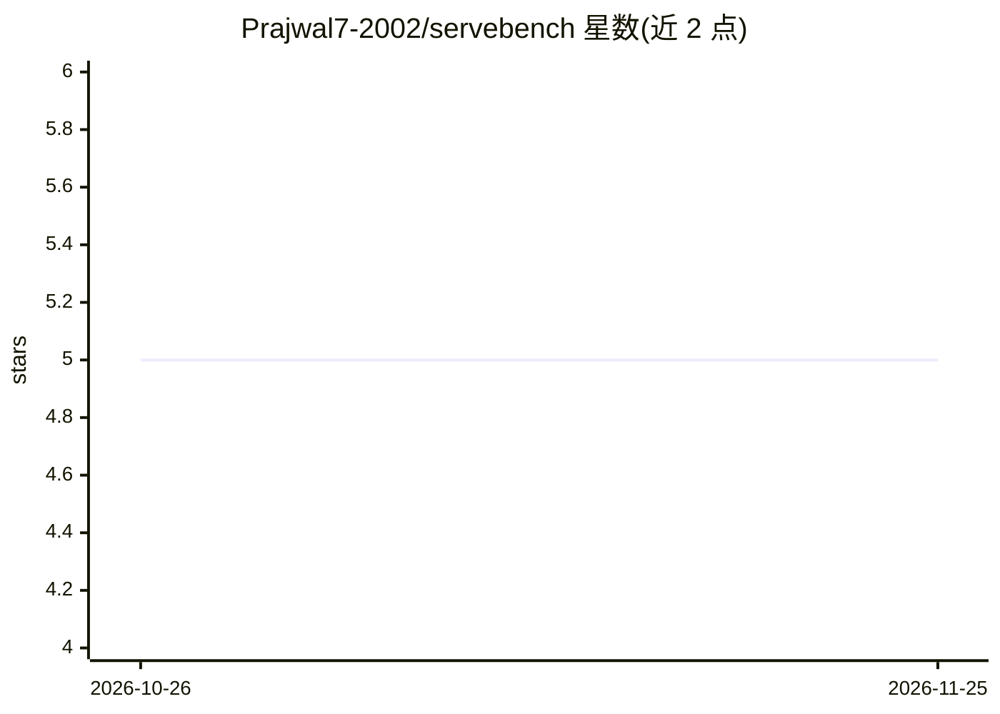

# Prajwal7-2002/servebench

⭐ 5 · HTML · Apache-2.0 · 推送 2026-11-14 · [GitHub](https://github.com/Prajwal7-2002/servebench) · [官网](https://prajwal7-2002.github.io/servebench/) · 个人维护

**给开发者一条命令压测本地 LLM 服务器的并发容量与延迟**

面向 OpenAI 兼容端点（Ollama、llama.cpp server、vLLM、SGLang 等）的负载测试 CLI：扫描不同并发档位，输出 TTFT、TPOT、ITL、吞吐/goodput 的 p50/p90/p99 与图表对比，客户端为纯 async Python 进程，无需在本机装 GPU 或引擎。附加机制包括：基于内置显卡规格库的 Roofline 分析（MBU/MFU）、按引擎生成启动参数的自动调优、类似 htop 的实时服务监控，以及 RunsOnMine 实测数据提交通道。

## 筛选速览

| 维度 | 判定 | 备注 |
|---|---|---|
| AI 角色 | `ai-ecosystem` | LLM/agent 周边工具 |
| 许可风险 | `permissive` | Apache-2.0 |
| 部署形态 | `library` | 以包/库形式分发 |
| 模型依赖 | local-ok | 支持本地模型 |
| 硬件要求 | — | 无带数字的原话,不猜 |
| 安装摩擦 | `low` | 无编译、无系统依赖或容器化 |
| 成熟度 | `idea` | |

## 能力要点

- 一条命令测得并发容量、TTFT/TPOT/吞吐的 p50/p90/p99 分位数据
- Roofline 分析判定 Memory-Bandwidth 或 Compute 瓶颈（MBU/MFU）
- 自动调优：检测延迟拐点并生成对应引擎的可复制启动参数
- 无引擎环境可用 servebench[mock] 的内置模拟服务器体验全部命令

## 适用场景

- 部署本地 LLM 前确定我的 GPU 能同时服务多少用户
- 对比不同引擎/配置在同一硬件上的延迟与吞吐表现
- 按 SLO（TTFT/TPOT 目标）生成 Ollama/vLLM 的并发与启动参数
- 提交实测结果帮助他人了解自己硬件能跑什么模型

## 场景标签

 · 领域:LLM 基础设施/评测工具

## 证据(README 行号)

> L12: Load-test any OpenAI-compatible LLM endpoint (Ollama, llama.cpp server, vLLM, SGLang, your
> L21: > Deploying and serving LLMs shouldn't require guessing concurrency numbers, tolerating latency spikes, or burning 

## 星数曲线

2026-10-26 5 → 2026-11-25 5（+0）

---
*卡片 v1 · prompt 1.4 · 生成 2026-11-21 · 置信度 high · 依据 README sha `53ed88cbdd2d` · [字段定义](../../DATASET.md)*
