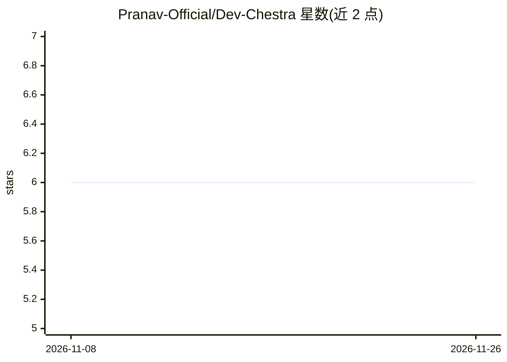

# Pranav-Official/Dev-Chestra

⭐ 6 · TypeScript · MIT · 推送 2026-11-10 · [GitHub](https://github.com/Pranav-Official/Dev-Chestra) · [官网](https://devchestra.dev) · 个人维护

**本地画布/CLI 工作流编排器：为无头编码 agent 编排流程**

DevChestra 是面向无头编码 CLI agent 的本地工作流构建器：在画布上绘制或让编码 agent 通过 CLI 生成工作流，以 Agent、Shell、Gate、Approval、Loop、For-each 等节点组合分支、循环与人工检查点，并按模型层（high/medium/low）映射到本机可用的 CLI 与模型。运行记录、转录与重放在编辑器中查看；CLI 输出 JSON，支持 headless 模式由 agent 创建、校验、运行与监控工作流。本地优先、单用户，需要 Node 22+ 与 pnpm/npm/bun。

## 筛选速览

| 维度 | 判定 | 备注 |
|---|---|---|
| AI 角色 | `ai-ecosystem` | LLM/agent 周边工具 |
| 许可风险 | `permissive` | MIT |
| 部署形态 | `library` | 以包/库形式分发 |
| 模型依赖 | — | README 未给出锁定关系 |
| 硬件要求 | — | 无带数字的原话,不猜 |
| 安装摩擦 | `low` | 无编译、无系统依赖或容器化 |
| 成熟度 | — | 结构信号不足 |

## 能力要点

- 画布与 CLI 共用同一套工作流节点词汇（Agent/Shell/Gate/Join/Approval/Decision/Loop 等）
- 模型层映射使同一工作流文件在不同机器上无需修改即可运行
- CLI 支持 JSON 输出与 headless 模式，agent 可创建、校验、运行并监控工作流
- 内置 Fix failing tests 起步工作流，覆盖测试-修复循环与人工审批

## 适用场景

- 把 bug 分诊到 PR 的流程固化为可重复运行的工作流
- PR 审查按风险路由并分支处理后续修复
- 非代码流程如 UGC 视频生产管线的分步编排

## 场景标签

`工作流自动化` · 领域:效率与自动化

## 证据(README 行号)

> L5: DevChestra is a local workflow builder for headless coding agents. Draw a workflow on the canvas or have your coding
> L17: DevChestra makes the boring parts deterministic. You build the process once — who runs, what tools and MCPs they ge
> L151: Works with the CLIs you already signed in to: Claude Code, Codex, OpenCode, and Pi. DevChestra never asks for thei

## 星数曲线

2026-11-08 6 → 2026-11-26 6（+0）

---
*卡片 v1 · prompt 1.4 · 生成 2026-11-20 · 置信度 high · 依据 README sha `52733d84fb3c` · [字段定义](../../DATASET.md)*
