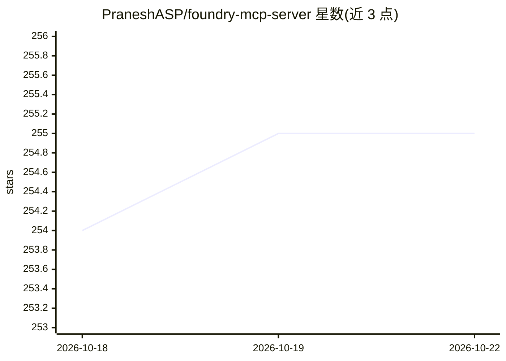

# PraneshASP/foundry-mcp-server

⭐ 255 · TypeScript · MIT · 推送 2026-01-17 · [GitHub](https://github.com/PraneshASP/foundry-mcp-server) · 个人维护

**为 Solidity 开发者连接 LLM 助手与 Foundry 工具链的 MCP 服务器**

一个 MCP 服务器，将 LLM 助手（Claude Desktop、Cursor、Claude Code、Windsurf 等 MCP 客户端）接入 Foundry 生态（Forge、Cast、Anvil）与 Heimdall-rs。能力包括：启动/管理本地 Anvil 实例或连接远程 RPC、合约只读调用与发交易（需配置 PRIVATE_KEY，可选）、维护 Forge 工作区并部署合约/运行脚本、EVM 字节码反汇编/反编译/控制流图、单位换算与钱包生成等工具函数。需 Node.js v18+ 与 Foundry 工具链；通过 npm 全局安装或 npx 直接运行，也可源码构建。README 末尾声明软件未经审计、按现状提供、使用风险自负。

## 筛选速览

| 维度 | 判定 | 备注 |
|---|---|---|
| AI 角色 | `ai-ecosystem` | LLM/agent 周边工具 |
| 许可风险 | `permissive` | MIT |
| 部署形态 | `library` | 以包/库形式分发 |
| 模型依赖 | — | README 未给出锁定关系 |
| 硬件要求 | — | 无带数字的原话,不猜 |
| 安装摩擦 | `low` | 无编译、无系统依赖或容器化 |
| 成熟度 | — | 结构信号不足 |

## 能力要点

- 连接 MCP 客户端执行 Solidity 编写、部署与链上操作
- 基于 Heimdall 的字节码反编译、calldata 解码与控制流图
- 本地 Anvil 实例管理与远程 RPC 接入
- npm/npx 分发，支持 Claude Code/Cursor/Windsurf 客户端配置

## 适用场景

- 在 IDE 的 AI 助手中直接部署合约和运行 Forge 脚本
- 让 AI 分析交易 trace 与反编译合约字节码
- 通过对话查询余额、估算 gas、发送交易

## 场景标签

 · 领域:区块链/智能合约开发工具

## 证据(README 行号)

> L3: A simple, lightweight and fast MCP (Model Context Protocol) server that provides Solidity development capabilities u
> L9: This server connects LLM assistants to the Foundry ecosystem, enabling them to:
> L62: The server is designed to be used as an MCP tool provider for MCP Clients. When connected to a client, it enables t

## 星数曲线

2026-10-18 254 → 2026-10-22 255（+1）

---
*卡片 v1 · prompt 1.4 · 生成 2026-10-22 · 置信度 high · 依据 README sha `a4e53c935aba` · [字段定义](../../DATASET.md)*
