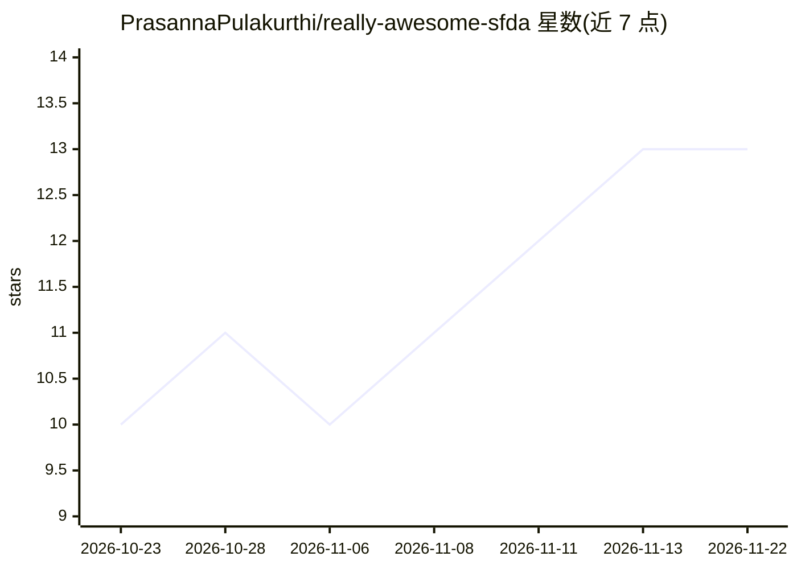

# PrasannaPulakurthi/really-awesome-sfda

⭐ 13 · Python · NOASSERTION · 推送 2026-11-19 · [GitHub](https://github.com/PrasannaPulakurthi/really-awesome-sfda) · 个人维护

**面向研究者的源Free域适应论文清单：收录论文/代码/基准**

收录 Source-Free Domain Adaptation 及相邻方向（test-time adaptation、open-set、持续与联邦设定）的论文列表，按时间倒序排列并标注会议与年份，存在代码的条目附链接。每条引用经 arXiv、Crossref 及 CVF/PMLR/NeurIPS/AAAI/IJCAI 会议记录机器核验，未通过核验的条目标记为 unverified。覆盖图像分类、目标检测、语义分割等应用场景。

## 筛选速览

| 维度 | 判定 | 备注 |
|---|---|---|
| AI 角色 | `ai-knowledge` | 知识聚合/清单类 |
| 许可风险 | `none` | NOASSERTION |
| 部署形态 | `None` |  |
| 模型依赖 | — | README 未给出锁定关系 |
| 硬件要求 | — | 无带数字的原话,不猜 |
| 安装摩擦 | `low` | 无编译、无系统依赖或容器化 |
| 成熟度 | — | 结构信号不足 |

## 能力要点

- 引用逐条对照出版方记录机器核验，venue/年份/代码链接不匹配即标记 unverified
- 覆盖 SFDA 及 test-time adaptation、open-set、持续与联邦等相邻变体
- 论文按时间倒序排列，标注 venue 与年份，有代码的条目附链接
- 按应用（分类/检测/分割）与综述/理论分节组织

## 适用场景

- 调研源Free域适应方向的最新论文与代码实现
- 为新研究寻找 SFDA 基线方法与数据集线索
- 跟踪 test-time adaptation 等相邻方向进展

## 场景标签

`精选清单` · 领域:学习与行业

## 证据(README 行号)

> L8: **Source-free domain adaptation** adapts a model to a new domain using only the
> L14: **Every citation here is machine-verified.** Each pull request resolves the
> L22: Papers are listed newest first, tagged with venue and year, and linked to code

## 星数曲线

2026-10-23 10 → 2026-11-22 13（+3）

---
*卡片 v1 · prompt 1.4 · 生成 2026-11-18 · 置信度 high · 依据 README sha `d0af2648f551` · [字段定义](../../DATASET.md)*
