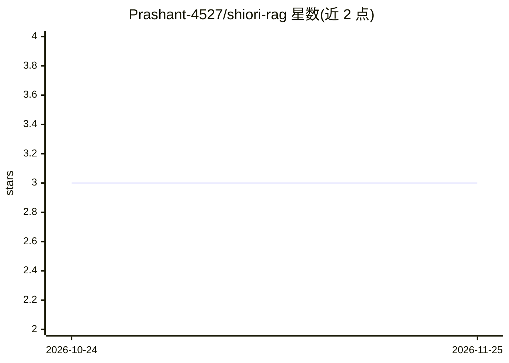

# Prashant-4527/shiori-rag

⭐ 3 · Python · 推送 2026-11-22 · [GitHub](https://github.com/Prashant-4527/shiori-rag) · 个人维护

**针对 METI 贸易白皮书的日英双语 RAG 问答原型，带页级引用**

面向 METI 贸易白皮书的日/英双语问答系统：仅从语料内检索作答，每条有证据的回答附文档名与 PDF 页码，语料证据不足时拒绝作答。仓库包含 PDF 页级抽取、规范化、分块模块与解析器对比、chunk 统计、naive v0 基线等实验脚本，并以固定问题集评测检索、引用、拒答、延迟与成本。当前为进行中的研究原型，解析器基准尚未验证，语料仅限 METI 托管文档。

## 筛选速览

| 维度 | 判定 | 备注 |
|---|---|---|
| AI 角色 | `ai-native` | 本体是模型或模型工具 |
| 许可风险 | `none` | — |
| 部署形态 | `None` |  |
| 模型依赖 | — | README 未给出锁定关系 |
| 硬件要求 | — | 无带数字的原话,不猜 |
| 安装摩擦 | `low` | 无编译、无系统依赖或容器化 |
| 成熟度 | `idea` | |

## 能力要点

- 仅基于语料作答并输出页级引用，无证据时明确拒答
- 固定 60 题评测集上测量各设计选择（检索、引用、拒答、延迟、成本）
- 解析器对比实验带锚点校验门槛，锚点全零命中时拒绝写入结果
- data/manifest.csv 记录每个文档的来源 URL、哈希、页数与许可信息

## 适用场景

- 用日语或英语查询 METI 贸易白皮书内容并获得页码出处
- 作为 RAG 设计选择（分块、抽取、引用策略）的评测研究项目
- 研究拒答机制在有证据边界约束的问答中的实现

## 场景标签

`RAG` `文档问答` · 领域:知识与检索

## 证据(README 行号)

> L3: Bilingual Japanese / English question answering over METI trade white papers, designed to return page-level citation
> L24: - Answer questions in Japanese or English using only the selected METI documents.
> L25: - Cite the source document and PDF page for every evidence-backed answer.
> L26: - Say when the documents do not contain enough evidence.

## 星数曲线

2026-10-24 3 → 2026-11-25 3（+0）

---
*卡片 v1 · prompt 1.4 · 生成 2026-11-22 · 置信度 high · 依据 README sha `cd4f05eaff09` · [字段定义](../../DATASET.md)*
