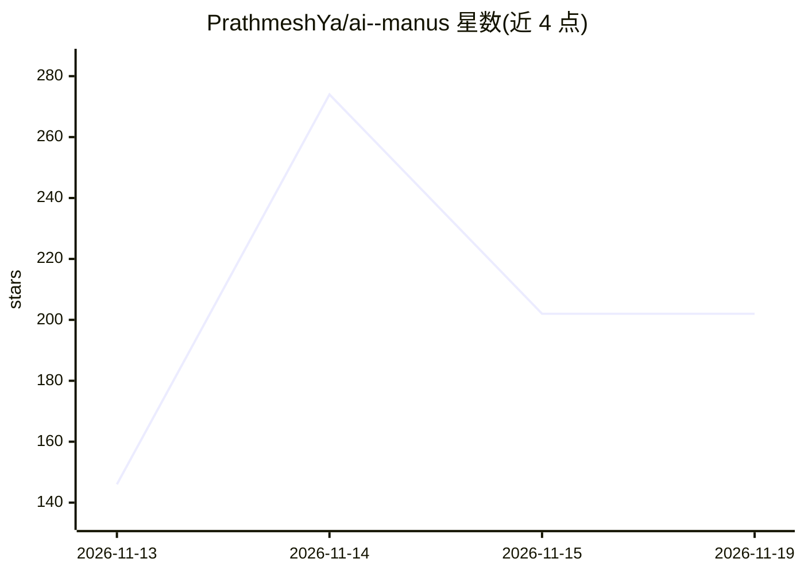

# PrathmeshYa/ai--manus

⭐ 202 · Apache-2.0 · 推送 2026-11-15 · [GitHub](https://github.com/PrathmeshYa/ai--manus) · 个人维护

**面向个人用户的自主 AI 代理：代为写代码并控制浏览器**

README 描述一个名为 Manus 的自主 AI 代理，面向学生、远程工作者和轻量办公用户：用户用自然语言下达指令，代理自行编写并执行脚本、打开网页、填写表单、完成多步骤任务。核心机制是代码执行与浏览器控制在同一工作流中衔接，并在会话间保持任务模式。定位为家庭、学习与轻量工作场景的小型助手，非企业平台。README 未提供安装命令、代码结构或 API 接入说明，仅给出下载提示与配置使用步骤；文末附大量搜索关键词，内容以功能介绍为主。

## 筛选速览

| 维度 | 判定 | 备注 |
|---|---|---|
| AI 角色 | `ai-native` | 本体是模型或模型工具 |
| 许可风险 | `permissive` | Apache-2.0 |
| 部署形态 | `None` |  |
| 模型依赖 | — | README 未给出锁定关系 |
| 硬件要求 | — | 无带数字的原话,不猜 |
| 安装摩擦 | `low` | 无编译、无系统依赖或容器化 |
| 成熟度 | — | 结构信号不足 |

## 能力要点

- 自主执行代码完成多步骤任务
- 代理控制浏览器：导航网页、填表、采集信息
- 代码与浏览器操作在同一工作流中衔接
- 会话间记住任务模式并可复用

## 适用场景

- 让代理代查网页信息并整理成摘要
- 自动填写重复性表单和执行小脚本
- 学习与轻办公中处理文件检查、资料收集等杂务

## 场景标签

`编码 Agent` `浏览器自动化` `AI 助手` · 领域:效率与自动化

## 证据(README 行号)

> L18: Manus is an autonomous AI agent designed to run code and control a browser on your behalf. Instead of acting like a
> L10: - **Autonomous Code Execution:** Manus AI agent runs code on its own to complete tasks, so you can focus on decisio

## 星数曲线

2026-11-13 146 → 2026-11-19 202（+56）

---
*卡片 v1 · prompt 1.4 · 生成 2026-11-17 · 置信度 low · 依据 README sha `a3d88e202bf0` · [字段定义](../../DATASET.md)*
