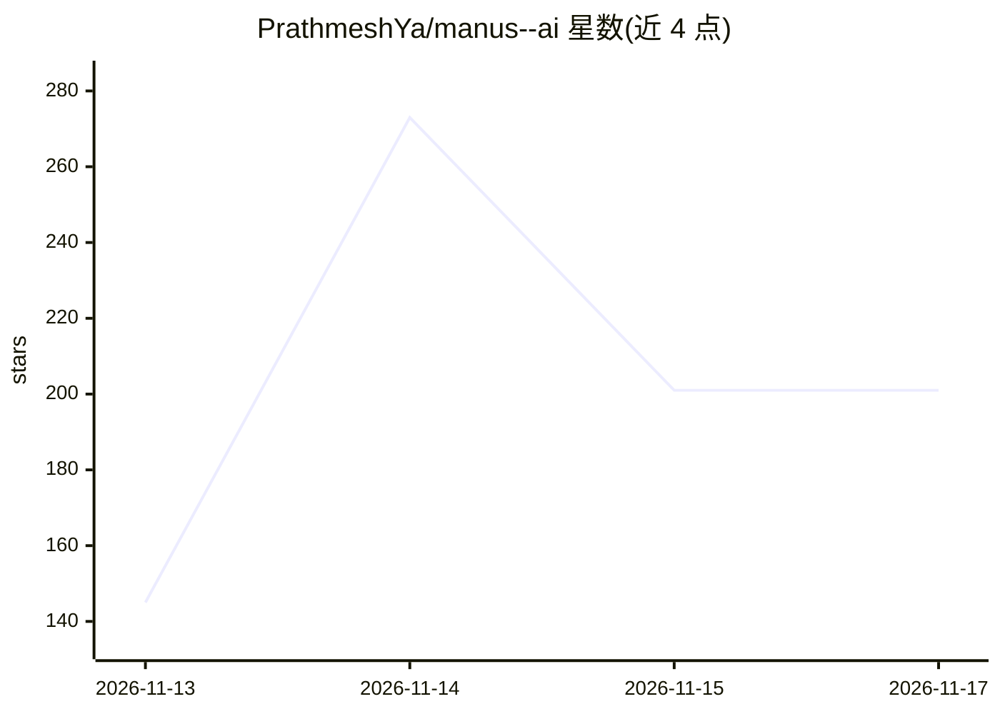

# PrathmeshYa/manus--ai

⭐ 201 · Apache-2.0 · 推送 2026-11-15 · [GitHub](https://github.com/PrathmeshYa/manus--ai) · 个人维护

**面向个人日常任务的自主 AI Agent：代跑代码与操作浏览器**

README 描述的 Manus 自主代理：替用户编写并执行脚本、控制浏览器（导航、填表、抓取信息），以多步骤任务减少手工操作。定位为家庭、学习与轻量办公场景的后台个人助手，非企业级平台。README 提供硬件兼容表（最低 4GB 内存、双核 CPU）与使用步骤说明，但未给出代码结构、依赖模型或安装运行命令，实施细节不可验证。

## 筛选速览

| 维度 | 判定 | 备注 |
|---|---|---|
| AI 角色 | `ai-native` | 本体是模型或模型工具 |
| 许可风险 | `permissive` | Apache-2.0 |
| 部署形态 | `None` |  |
| 模型依赖 | — | README 未给出锁定关系 |
| 硬件要求 | — | 无带数字的原话,不猜 |
| 安装摩擦 | `low` | 无编译、无系统依赖或容器化 |
| 成熟度 | — | 结构信号不足 |

## 能力要点

- 自主执行代码与脚本任务
- 浏览器控制：导航网页、填写表单、收集信息
- 代码与浏览器操作可在同一工作流中衔接

## 适用场景

- 让学生整理研究资料、跑小型脚本
- 代为完成查网页、填表等重复性线上操作
- 远程工作者从多个页面收集信息并汇总

## 场景标签

`AI 助手` `浏览器自动化` · 领域:效率与自动化

## 证据(README 行号)

> L10: - **Autonomous Code Execution:** Manus AI agent runs code on its own to complete tasks, so you can focus on decisio
> L11: - **Browser Control Made Simple:** Manus browser control lets the agent navigate websites, fill forms, and gather i
> L18: Manus is an autonomous AI agent designed to run code and control a browser on your behalf. Instead of acting like a

## 星数曲线

2026-11-13 145 → 2026-11-17 201（+56）

---
*卡片 v1 · prompt 1.4 · 生成 2026-11-17 · 置信度 mid · 依据 README sha `a3d88e202bf0` · [字段定义](../../DATASET.md)*
