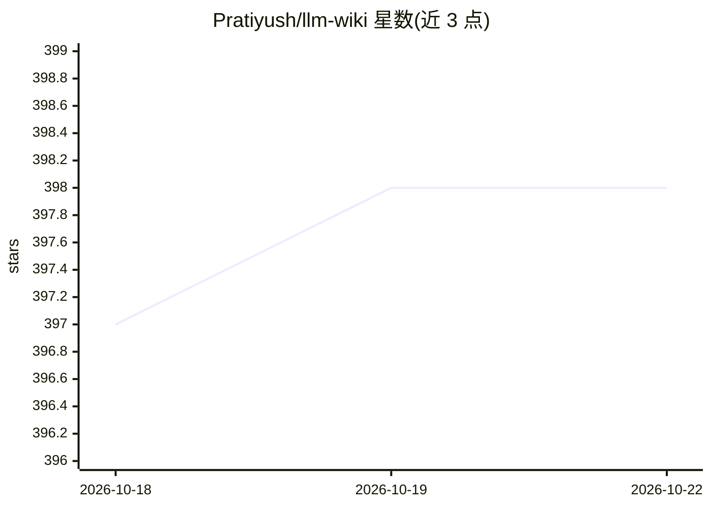

# Pratiyush/llm-wiki

⭐ 398 · Python · MIT · 推送 2026-06-18 · [GitHub](https://github.com/Pratiyush/llm-wiki) · 个人维护

**把 AI 编码会话记录转成可检索知识库的本地 CLI 工具**

Python CLI 工具 llmwiki，读取 Claude Code、Codex CLI、Copilot、Cursor、Gemini CLI 与 Obsidian 写入磁盘的 .jsonl 会话转录，将其转换为含 sources/entities/concepts/syntheses 页面、以 [[wikilinks]] 互链的静态知识站点，本地两条命令即可构建并部署到 GitHub Pages。每页附 .txt/.json 机器可读副本与站点级 llms.txt、graph.jsonld 入口，供其他 AI agent 查询；提供 MCP server（12 个工具）、Obsidian 集成、16 条 lint 规则与会话自动同步 hook。LLM 摘要可选接 Ollama 或本地后端，不配也可运行（dummy 模式）。

## 筛选速览

| 维度 | 判定 | 备注 |
|---|---|---|
| AI 角色 | `ai-ecosystem` | LLM/agent 周边工具 |
| 许可风险 | `permissive` | MIT |
| 部署形态 | `self-host` | docker 或自建部署 |
| 模型依赖 | local-ok | 支持本地模型 |
| 硬件要求 | — | 无带数字的原话,不猜 |
| 安装摩擦 | `low` | 无编译、无系统依赖或容器化 |
| 成熟度 | — | 结构信号不足 |

## 能力要点

- 从 5 种编码 agent 的磁盘会话转录生成本地静态 wiki 站点
- 每页 .txt/.json 副本 + llms.txt / graph.jsonld 等 AI 可消费导出
- MCP server 提供 12 个查询/检索/lint 工具，可从 Claude Desktop、Cursor 等客户端调用
- 4 因子置信度评分 + 5 态生命周期 + 16 条 lint 规则的内容治理

## 适用场景

- 把积累的 Claude Code/Codex 等会话历史变成可搜索、可互链的个人知识库
- 让其他 AI agent 通过 llms.txt、JSON-LD 图或 MCP server 直接查询我的工作记录
- 把 wiki 以 symlink 方式接入 Obsidian 获得 graph view 与 Dataview 面板

## 场景标签

`知识库管理` · 领域:知识与检索

## 证据(README 行号)

> L25: Every Claude Code, Codex CLI, Copilot, Cursor, and Gemini CLI session writes a full transcript to disk. You already
> L27: **llmwiki** turns that dormant history into a beautiful, searchable, interlinked knowledge base — locally, in two c
> L151: - **MCP server** — 12 production tools (query, search, list, read, lint, sync, export, + confidence, lifecycle, da

## 星数曲线

2026-10-18 397 → 2026-10-22 398（+1）

---
*卡片 v1 · prompt 1.4 · 生成 2026-10-21 · 置信度 mid · 依据 README sha `a62db1e06c3c` · [字段定义](../../DATASET.md)*
