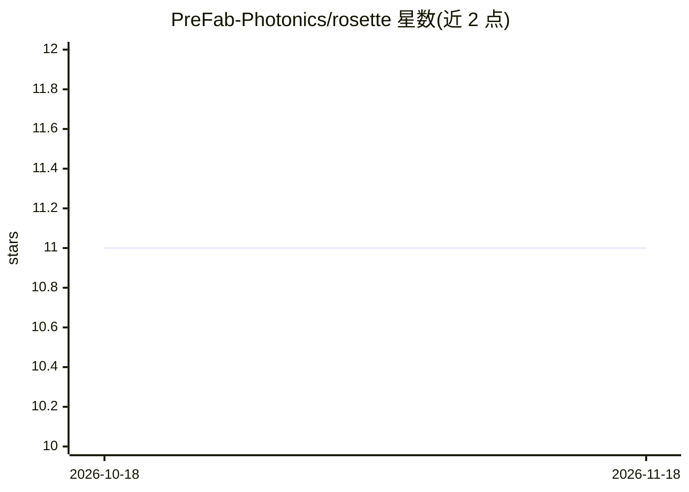

# PreFab-Photonics/rosette

⭐ 11 · Rust · MIT · 推送 2026-09-11 · [GitHub](https://github.com/PreFab-Photonics/rosette) · [官网](https://www.rosette.dev) · 组织维护

**面向编码代理的光子 GDS-II 版图工具链**

Rosette 是一个可脚本化的集成光子学 GDS-II 版图环境，结合类型化 Python API、Rust 核心与本地 WebGPU 查看器，支持版图设计、规则检查与预览。它不自带模型或聊天界面，而是通过 rosette init 为 Claude Code 及 AGENTS.md 兼容工具（OpenCode、Codex、Cursor 等）提供项目指令、API 契约、机器可读层与设计规则配置及技能，使代理以常规 Python 文件工作并自行验证。README 明确标注为 beta 软件，API 不稳定，不适合生产使用。

## 筛选速览

| 维度 | 判定 | 备注 |
|---|---|---|
| AI 角色 | `ai-ecosystem` | LLM/agent 周边工具 |
| 许可风险 | `permissive` | MIT |
| 部署形态 | `None` |  |
| 模型依赖 | — | README 未给出锁定关系 |
| 硬件要求 | — | 无带数字的原话,不猜 |
| 安装摩擦 | `low` | 无编译、无系统依赖或容器化 |
| 成熟度 | `idea` | |

## 能力要点

- 类型化 Python API 加 Rust 核心，支持 GDS-II 导入导出
- rosette init 为编码代理生成指令、API 契约与设计规则配置
- DRC、连通性与弯折检查，结果对人和代理均可执行
- 本地 WebGPU 查看器提供 GPU 渲染与只读热重载

## 适用场景

- 用编码代理编写并迭代光子版图 Python 脚本
- 对光子设计做设计规则与连通性检查并导出 GDS-II
- 本地可视化检视完整设计或特定区域

## 场景标签

 · 领域:光子学 EDA/芯片设计工具

## 证据(README 行号)

> L19: Rosette does not ship its own model or proprietary chat interface. It works with
> L23: `rosette init` gives those agents the material they need to work effectively:

## 星数曲线

2026-10-18 11 → 2026-11-18 11（+0）

---
*卡片 v1 · prompt 1.4 · 生成 2026-11-18 · 置信度 high · 依据 README sha `f4d763ebffdc` · [字段定义](../../DATASET.md)*
