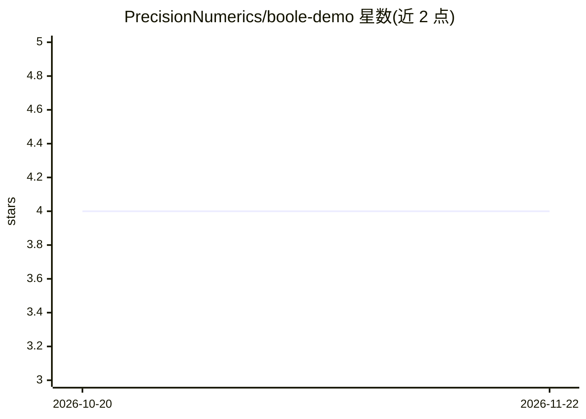

# PrecisionNumerics/boole-demo

⭐ 4 · Python · Apache-2.0 · 推送 2026-11-20 · [GitHub](https://github.com/PrecisionNumerics/boole-demo) · [官网](https://precisionnumerics.ai/) · 组织维护

**本地运行 Boole 1-bit 模型的演示仓库**

PrecisionNumerics 提供的演示仓库，用于在本机运行 Boole 模型（Boole-32B-A2.5B-Preview 与 Boole-1.7B）。提供两条运行路径：通过仓库固定的 llama.cpp fork 加载 GGUF 量化文件启动 llama-server；或通过 pip 安装本包，用 boole-prep 命令将 safetensors 检查点导出为 vLLM 模型目录（注册 vLLM 插件加载 1-bit 嵌入层），再由 vLLM serve。需要 Python 3.10+；32B 模型需 CUDA GPU（32K 上下文约 10.9 GB 显存），1.7B 模型可仅用 CPU。模型权重与运行时代码采用 Apache License 2.0。

## 筛选速览

| 维度 | 判定 | 备注 |
|---|---|---|
| AI 角色 | `ai-ecosystem` | LLM/agent 周边工具 |
| 许可风险 | `permissive` | Apache-2.0 |
| 部署形态 | `library` | 以包/库形式分发 |
| 模型依赖 | local-ok | 支持本地模型 |
| 硬件要求 | `cpu-ok` | |
| 安装摩擦 | `medium` | 含编译或系统依赖之一 |
| 成熟度 | — | 结构信号不足 |

## 能力要点

- 支持 llama.cpp（pinned fork）加载 GGUF 量化模型并启动本地推理服务
- boole-prep 命令将检查点导出为 vLLM 模型目录，安装时注册 vLLM 插件加载 1-bit 嵌入与输出头
- Boole-1.7B GGUF 仅 292.1 MB，支持纯 CPU 运行
- 模型回答前可输出独立返回的推理（reasoning）内容

## 适用场景

- 在自己机器上本地运行 1-bit 量化的 Boole 模型
- 在无 GPU 的 CPU 环境运行 1.7B 小模型推理
- 通过 vLLM + Humming 内核在单张 CUDA GPU 上服务 1-bit 模型

## 场景标签

`推理引擎` · 领域:训练与推理

## 证据(README 行号)

> L5:  Run Boole models on your own machine.
> L15: |Boole-32B-A2.5B-Preview|llama.cpp|Boole-32B-A2.5B-Preview-Q2_0.gguf (9.0 GB)|CUDA GPU|
> L96: `boole-prep` downloads the packed checkpoint and writes a vLLM model directory. Installing

## 星数曲线

2026-10-20 4 → 2026-11-22 4（+0）

---
*卡片 v1 · prompt 1.4 · 生成 2026-11-21 · 置信度 high · 依据 README sha `539540ef2fb3` · [字段定义](../../DATASET.md)*
