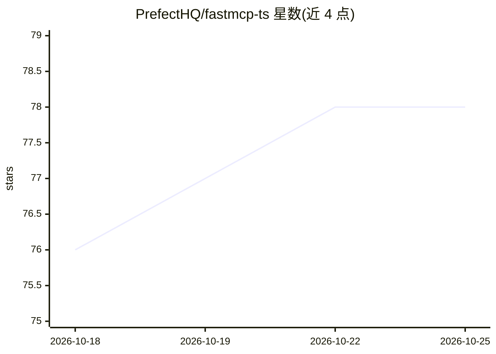

# PrefectHQ/fastmcp-ts

⭐ 80 · TypeScript · 推送 2026-10-20 · [GitHub](https://github.com/PrefectHQ/fastmcp-ts) · [官网](https://fastmcp-ts.docs.prefect.io) · 组织维护

**构建 MCP 服务器、客户端与交互应用的 TypeScript 框架**

由 Prefect 团队维护的 TypeScript 框架，是 Python 版 FastMCP 的官方对应实现，基于官方 MCP TypeScript SDK v2。提供将 TypeScript 函数转为 MCP 工具/资源/提示的服务器构建能力（Zod/Valibot/ArkType 自动推断 schema）、客户端连接与多服务器命名空间、LLM sampling 适配器（Anthropic/OpenAI/Google）、中间件与 JWT 认证、子服务器挂载组合、在 MCP 会话中渲染交互 UI 的组件库。同时兼容 2025 与 2026-07-28 两代 MCP 协议并自动协商。附带 fastmcp CLI 用于运行、检查与调用服务器。

## 筛选速览

| 维度 | 判定 | 备注 |
|---|---|---|
| AI 角色 | `ai-ecosystem` | LLM/agent 周边工具 |
| 许可风险 | `none` | — |
| 部署形态 | `library` | 以包/库形式分发 |
| 模型依赖 | — | README 未给出锁定关系 |
| 硬件要求 | — | 无带数字的原话,不猜 |
| 安装摩擦 | `low` | 无编译、无系统依赖或容器化 |
| 成熟度 | — | 结构信号不足 |

## 能力要点

- TypeScript 函数自动生成 MCP 工具/资源/提示，支持多种 schema 库
- 内置 Anthropic/OpenAI/Google sampling 适配器，一行转发 LLM 采样请求
- 服务器端组件库构建 MCP 会话内交互 UI（含生成式 UI）
- 同一服务器同时服务两代 MCP 协议（2025/2026-07-28），客户端自动协商

## 适用场景

- 为 LLM agent 开发自定义 MCP 工具服务器
- 编写连接多个 MCP 服务器的客户端程序
- 在 MCP 会话中提供交互式 UI 应用

## 场景标签

`Agent 框架` · 领域:Agent 开发

## 证据(README 行号)

> L3: The TypeScript framework for building Model Context Protocol servers, clients, and apps. The official TypeScript cou
> L5: Built on version 2 of the official MCP TypeScript SDK — the scoped `@modelcontextprotocol/server` and `@modelcontext

## 星数曲线

2026-10-18 76 → 2026-10-25 78（+2）

---
*卡片 v1 · prompt 1.4 · 生成 2026-10-24 · 置信度 mid · 依据 README sha `8bb302208ea8` · [字段定义](../../DATASET.md)*
