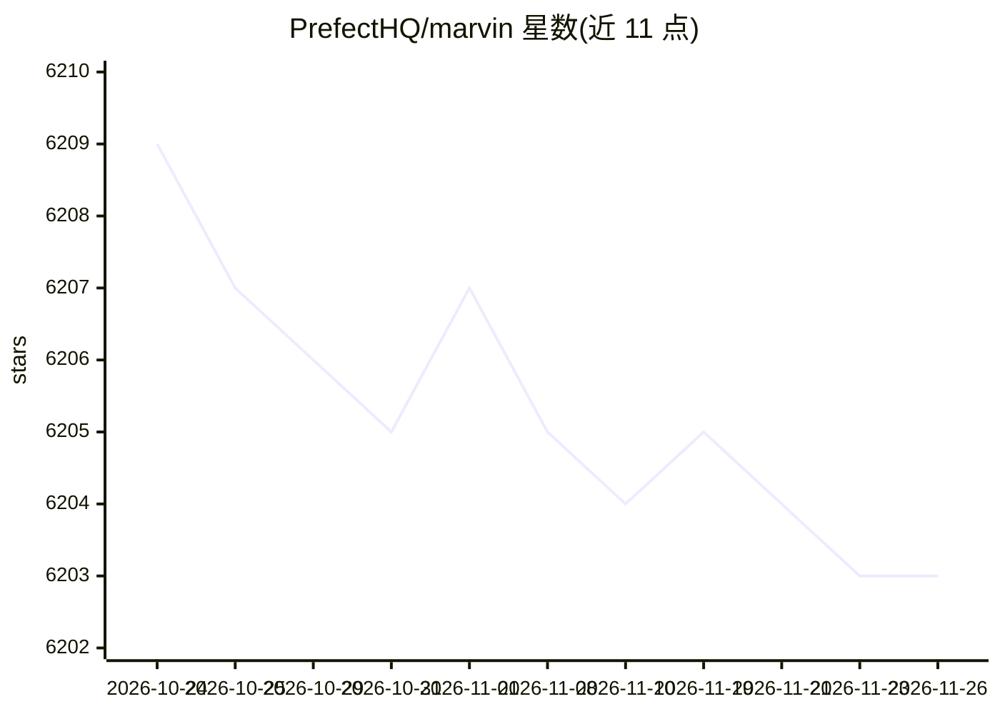

# PrefectHQ/marvin

⭐ 6,203 · Python · Apache-2.0 · 推送 2026-11-20 · [GitHub](https://github.com/PrefectHQ/marvin) · [官网](https://marvin.mintlify.app) · 组织维护

**Python 库：用 LLM 提取结构化数据并执行任务**

由 Prefect 维护的 Python 库，基于 Pydantic AI 访问模型，在其上提供带类型标注的任务、工具与会话历史能力。提供 cast（产出单值）、extract（提取列表）、classify（选择标签）、generate（生成示例）四个函数及异步版本；对需要指令、上下文或工具的工作提供 Task 机制；Agent 可复用模型设置、指令与工具，Thread 跨调用共享对话历史并存入数据库。要求 Python 3.11+，默认使用 OpenAI，需配置模型服务商凭证。文档发布于 askmarvin.ai。

## 筛选速览

| 维度 | 判定 | 备注 |
|---|---|---|
| AI 角色 | `ai-native` | 本体是模型或模型工具 |
| 许可风险 | `permissive` | Apache-2.0 |
| 部署形态 | `library` | 以包/库形式分发 |
| 模型依赖 | — | README 未给出锁定关系 |
| 硬件要求 | — | 无带数字的原话,不猜 |
| 安装摩擦 | `low` | 无编译、无系统依赖或容器化 |
| 成熟度 | — | 结构信号不足 |

## 能力要点

- cast/extract/classify/generate 四类类型化任务，均含异步版本
- Agent 复用模型设置、指令与工具；Thread 跨调用共享并持久化会话历史
- 基于 Pydantic AI 构建模型访问层

## 适用场景

- 从非结构化文本中提取类型化字段
- 用 LLM 对输入文本做标签分类
- 构建带工具调用与持久化历史的对话/任务流

## 场景标签

`Agent 框架` · 领域:Agent 开发

## 证据(README 行号)

> L5: Marvin is a Python library for extracting structured data and running tasks with language models. It builds on Pydan
> L27: Use `cast` to produce one value, `extract` to find a list of values, `classify` to choose labels, and `generate` to

## 星数曲线

2026-10-24 6,209 → 2026-11-26 6,203（-6）

---
*卡片 v1 · prompt 1.4 · 生成 2026-11-22 · 置信度 high · 依据 README sha `6a59009053be` · [字段定义](../../DATASET.md)*
