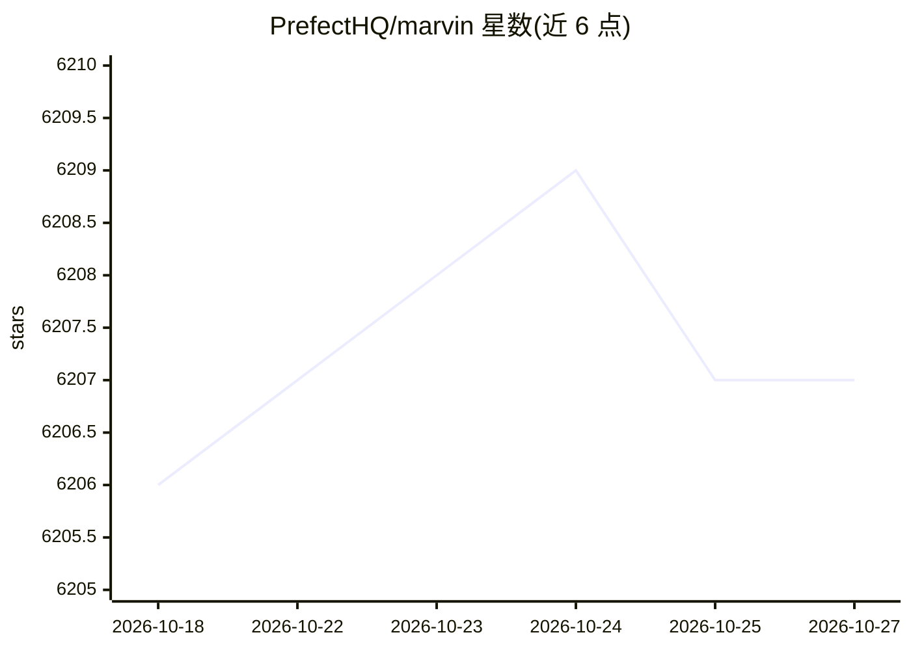

# PrefectHQ/marvin

⭐ 6,207 · Python · Apache-2.0 · 推送 2026-09-23 · [GitHub](https://github.com/PrefectHQ/marvin) · [官网](https://marvin.mintlify.app) · 组织维护

**构建 AI agent 工作流与结构化输出的 Python 框架**

面向开发者的 Python 库，提供 extract/cast/classify/generate 等结构化输出工具，以及 Task/Agent/Thread 抽象来编排 agentic AI 工作流：可将目标拆解为任务、指派专职 agent、组合成共享上下文的线程，3.0 版合并了 ControlFlow 的引擎。模型接入默认使用 OpenAI，底层改用 Pydantic AI，因此支持 Pydantic AI 所支持的全部 LLM 供应商。线程历史存储在 SQLite，开发阶段暂无数据库迁移，升级需重置数据。

## 筛选速览

| 维度 | 判定 | 备注 |
|---|---|---|
| AI 角色 | `ai-ecosystem` | LLM/agent 周边工具 |
| 许可风险 | `permissive` | Apache-2.0 |
| 部署形态 | `library` | 以包/库形式分发 |
| 模型依赖 | — | README 未给出锁定关系 |
| 硬件要求 | — | 无带数字的原话,不猜 |
| 安装摩擦 | `low` | 无编译、无系统依赖或容器化 |
| 成熟度 | — | 结构信号不足 |

## 能力要点

- extract/cast/classify/generate 结构化输出工具函数
- Task/Agent/Thread 多 agent 编排与任务依赖规划
- 基于 Pydantic AI 接入多家 LLM 供应商，默认 OpenAI
- 线程历史存储于 SQLite，内置上下文共享与恢复

## 适用场景

- 从非结构化文本提取类型安全的数据
- 把复杂目标拆成多任务并指派多个 AI agent 协作完成
- 构建带类型校验输出的 LLM 工作流应用

## 场景标签

`Agent 框架` `多智能体` · 领域:Agent 开发

## 证据(README 行号)

> L5: Marvin is a Python framework for producing structured outputs and building agentic AI workflows.
> L7: Marvin provides an intuitive API for defining workflows and delegating work to LLMs:
> L269: - **Pydantic AI**: Marvin 3.0 uses Pydantic AI for LLM interactions, and supports the full range of LLM providers 

## 星数曲线

2026-10-18 6,206 → 2026-10-27 6,207（+1）

---
*卡片 v1 · prompt 1.4 · 生成 2026-10-20 · 置信度 high · 依据 README sha `833331934d4f` · [字段定义](../../DATASET.md)*
