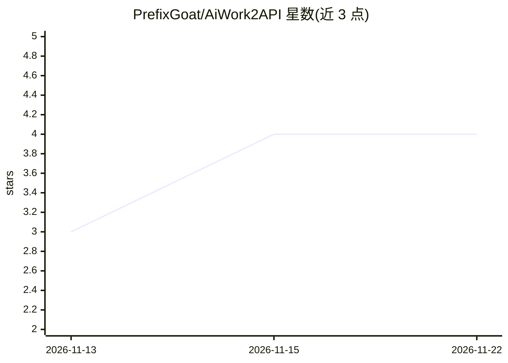

# PrefixGoat/AiWork2API

⭐ 4 · JavaScript · MIT · 推送 2026-11-13 · [GitHub](https://github.com/PrefixGoat/AiWork2API) · [官网](https://github.com/PrefixGoat/AiWork2API#readme) · 个人维护 · 中文 README

**给 AiWork 账号提供 OpenAI/Anthropic 兼容 API 的自托管网关**

自托管的协议转换网关（Node.js 实现），将 AiWork 账号包装为遵循 OpenAI / Anthropic 协议的 API 服务，提供 Chat Completions、Responses（Codex）与 Messages（Claude Code）三种接入协议。关键机制包括：账号池轮询分配会话、响应前自动换号重试、按小时/天分组的用量账本、含六个标签页的管理控制台（Key 签发吊销、模型别名、日志）。限制方面：需宿主机已登录官方 CLI，服务默认仅监听 127.0.0.1，automodel 不支持多轮工具调用，单账号并发有限，仅限个人自托管。

## 筛选速览

| 维度 | 判定 | 备注 |
|---|---|---|
| AI 角色 | `ai-ecosystem` | LLM/agent 周边工具 |
| 许可风险 | `permissive` | MIT |
| 部署形态 | `self-host` | docker 或自建部署 |
| 模型依赖 | — | README 未给出锁定关系 |
| 硬件要求 | — | 无带数字的原话,不猜 |
| 安装摩擦 | `low` | 无编译、无系统依赖或容器化 |
| 成熟度 | — | 结构信号不足 |

## 能力要点

- 三种协议（Chat Completions / Responses / Messages）共用一条调度链路
- 多账号池轮询分配，支持响应前自动换号重试
- 按小时/天、账号/模型/凭据分组的用量账本
- 自带管理控制台：API Key 签发吊销、账号范围限制、模型别名映射

## 适用场景

- 让 Codex CLI 或 Claude Code 通过本地网关调用 AiWork 账号
- 给 Cursor、LobeChat、Dify 等客户端提供统一的 OpenAI 兼容接口
- 自托管场景下统计多个账号的调用量与额度使用情况

## 场景标签

`模型网关` · 领域:Agent 开发

## 证据(README 行号)

> L5:  把 AiWork 账号变成 OpenAI / Anthropic 兼容的 API
> L117: - 三种协议共用同一条调度链路：Chat Completions 原生支持，Responses（Codex）与 Messages（Claude Code）分别通过适配层转换

## 星数曲线

2026-11-13 3 → 2026-11-22 4（+1）

---
*卡片 v1 · prompt 1.4 · 生成 2026-11-21 · 置信度 high · 依据 README sha `3118b7997475` · [字段定义](../../DATASET.md)*
