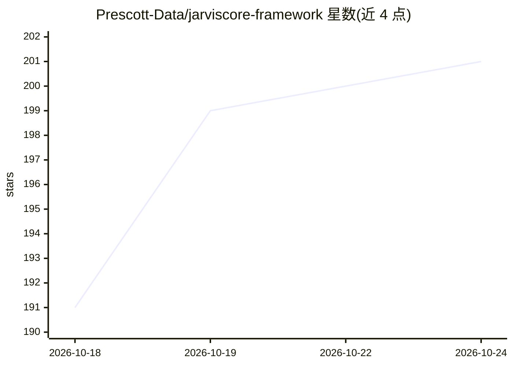

# Prescott-Data/jarviscore-framework

⭐ 172 · Python · Apache-2.0 · 推送 2026-10-24 · [GitHub](https://github.com/Prescott-Data/jarviscore-framework) · [官网](https://jarviscore.developers.prescottdata.io/) · 组织维护

**多智能体对等网络运行时框架，含零信任凭证与故障恢复**

Python 多智能体系统框架：智能体通过 SWIM gossip（ZMQ 传输）组成对等 mesh，无中央编排器，按能力发现彼此并从 Redis 共享账本原子性认领工作流步骤；kill -9 后重跑同一 workflow id 可恢复已完成步骤。内置 Nexus 零信任凭证代理（加密 OAuth/API key 并在调用时注入，智能体不接触原始密钥）、Athena 知识图谱共享记忆、FAISS RAG 管线、无头浏览器自动化与联网搜索。集成以单文件 atom 形式注册，覆盖 150 个外部服务；提供 AutoAgent/CustomAgent 两类智能体画像与 OODA 内核。分布式功能依赖 Redis。

## 筛选速览

| 维度 | 判定 | 备注 |
|---|---|---|
| AI 角色 | `ai-ecosystem` | LLM/agent 周边工具 |
| 许可风险 | `permissive` | Apache-2.0 |
| 部署形态 | `self-host` | docker 或自建部署 |
| 模型依赖 | — | README 未给出锁定关系 |
| 硬件要求 | — | 无带数字的原话,不猜 |
| 安装摩擦 | `low` | 无编译、无系统依赖或容器化 |
| 成熟度 | — | 结构信号不足 |

## 能力要点

- SWIM gossip 对等 mesh 发现 + Redis 步骤认领与崩溃恢复
- Nexus 零信任凭证代理：加密密钥在调用时注入，智能体不接触原始密钥
- 150 个外部服务集成为单文件 atom，可自写自测注册
- Athena 知识图谱跨智能体共享记忆 + FAISS RAG 管线

## 适用场景

- 搭建跨机器、无中央编排器的多智能体工作流
- 让智能体在执行任务时接入外部服务且不持有原始密钥
- 需要故障恢复（kill -9 后不重跑已完成步骤）的 agent 生产部署

## 场景标签

`Agent 框架` `多智能体` `浏览器自动化` · 领域:Agent 开发

## 证据(README 行号)

> L3:  The production runtime for multi-agent systems — a peer-to-peer mesh with no central orchestrator, zero-trust crede
> L48: JarvisCore is a Python framework for building AI agent systems that can plan, reason, execute code, browse the web,
> L233: ### P2P Mesh and Distributed Workflows

## 星数曲线

2026-10-18 191 → 2026-10-24 201（+10）

---
*卡片 v1 · prompt 1.4 · 生成 2026-10-22 · 置信度 mid · 依据 README sha `ac429bf5c30b` · [字段定义](../../DATASET.md)*
