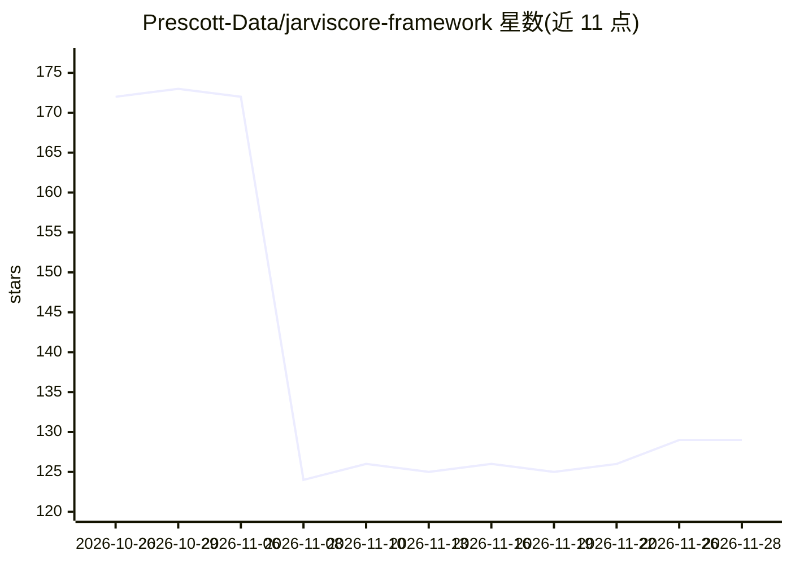

# Prescott-Data/jarviscore-framework

⭐ 129 · Python · Apache-2.0 · 推送 2026-11-25 · [GitHub](https://github.com/Prescott-Data/jarviscore-framework) · [官网](https://jarviscore.developers.prescottdata.io/) · 组织维护

**多 AI agent 对等网格运行时，供开发者构建协作代理**

JarvisCore 是一个 AI agent 运行时，让多个代理以对等节点组成网格运行：通过 SWIM 机制按能力互相发现、从 Redis 共享账本认领步骤并在崩溃后恢复进度；对外部服务的凭证由 Nexus 零信任代理在调用时注入，代理自身不持有密钥。提供 AutoAgent（声明式）与 CustomAgent（Python）两种编写方式，附浏览器、P2P、语义记忆等可选模块与 CLI。安装仅需 Python 3.10+ 与一个模型 key，无需数据库或 Docker。

## 筛选速览

| 维度 | 判定 | 备注 |
|---|---|---|
| AI 角色 | `ai-ecosystem` | LLM/agent 周边工具 |
| 许可风险 | `permissive` | Apache-2.0 |
| 部署形态 | `library` | 以包/库形式分发 |
| 模型依赖 | — | README 未给出锁定关系 |
| 硬件要求 | — | 无带数字的原话,不猜 |
| 安装摩擦 | `low` | 无编译、无系统依赖或容器化 |
| 成熟度 | — | 结构信号不足 |

## 能力要点

- 对等网格与共享账本：kill -9 后从 Redis 恢复已完成步骤
- Nexus 零信任凭证代理在调用时注入 token，凭证不进入提示词或生成代码
- AutoAgent/CustomAgent 两种编写方式，Pool 支持单代理扩为多 worker
- 跨运行持久记忆与 Mesh.resolve_hitl() 人工审批

## 适用场景

- 搭建多 agent 协作的研究/分析团队工作流
- 需要进程崩溃后不重跑已完成步骤的长任务
- 希望代理访问 CRM、邮箱等外部服务但不下发密钥
- 在 Slack 中让人审批代理对共享文件的修改

## 场景标签

`Agent 框架` `多智能体` `工作流自动化` · 领域:Agent 开发

## 证据(README 行号)

> L13: **JarvisCore** is a runtime where AI agents operate as a fleet of equal peers. Agents
> L19: Most agent frameworks put one **orchestrator** in charge: it plans, routes every request
> L36: JarvisCore puts eight components around the model: **AutoAgent, CustomAgent, the

## 星数曲线

2026-10-26 172 → 2026-11-28 129（-43）

---
*卡片 v1 · prompt 1.4 · 生成 2026-11-28 · 置信度 high · 依据 README sha `bb0b53d80322` · [字段定义](../../DATASET.md)*
