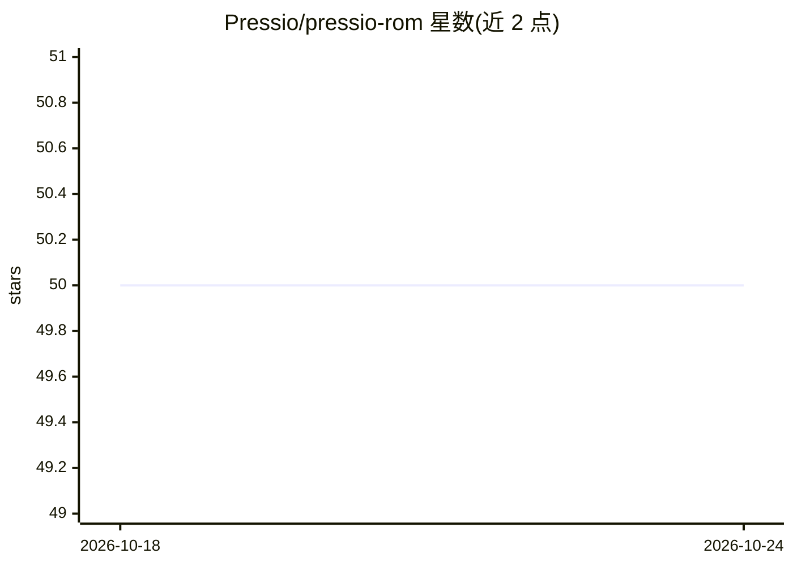

# Pressio/pressio-rom

⭐ 50 · C++ · NOASSERTION · 推送 2026-02-10 · [GitHub](https://github.com/Pressio/pressio-rom) · 组织维护

**面向科学工程的降阶模型（ROM）C++ 计算框架**

Pressio 是一个开源 C++ 计算框架，用于科学工程中动力系统的降阶模型（ROM）。采用泛型编程，支持共享内存与分布式内存应用、任意数据类型与多种编程模型。库由多个可独立、自包含使用的组件构成，整体构成 ROM 组件的技术栈基础；即使不关注 ROM，也可单独使用其中部分组件。项目尚未达到稳定 1.0，各组件成熟度不一，0.x 版本间 API 与功能可能较快变化、影响向后兼容。README 未给出安装命令细节，文档另见官方网站。

## 筛选速览

| 维度 | 判定 | 备注 |
|---|---|---|
| AI 角色 | `ai-ecosystem` | LLM/agent 周边工具 |
| 许可风险 | `none` | NOASSERTION |
| 部署形态 | `None` |  |
| 模型依赖 | — | README 未给出锁定关系 |
| 硬件要求 | — | 无带数字的原话,不猜 |
| 安装摩擦 | `low` | 无编译、无系统依赖或容器化 |
| 成熟度 | `idea` | |

## 能力要点

- 降阶模型（ROM）组件栈，组件可独立自包含使用
- 泛型编程，支持共享内存与分布式内存
- 支持任意数据类型与多种编程模型

## 适用场景

- 为科学工程动力系统构建降阶模型
- 复用其中的线性/非线性求解器与时间积分组件
- 在 HPC 分布式内存环境中运行 ROM 计算

## 场景标签

 · 领域:科学计算/高性能计算

## 证据(README 行号)

> L3: Pressio is an open-source computational framework aimed at advancing
> L4: the field of reduced-order models (ROMs) for dynamical systems in science and engineering.

## 星数曲线

2026-10-18 50 → 2026-10-24 50（+0）

---
*卡片 v1 · prompt 1.4 · 生成 2026-10-24 · 置信度 mid · 依据 README sha `32b18759953a` · [字段定义](../../DATASET.md)*
