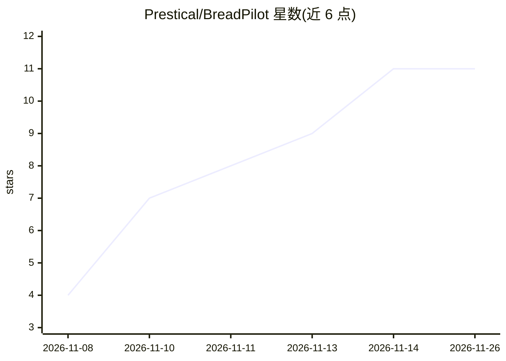

# Prestical/BreadPilot

⭐ 11 · TypeScript · Apache-2.0 · 推送 2026-11-22 · [GitHub](https://github.com/Prestical/BreadPilot) · 个人维护

**把硬件点子变成 3D 面包板接线步骤与 MicroPython 代码的桌面应用**

BreadPilot 是面向 Raspberry Pi Pico 2 W 的桌面应用（Electron，macOS/Windows/Linux）：用户用自然语言描述硬件点子，应用生成电路方案、编号的 3D 面包板接线步骤和经交叉检查的 MicroPython 代码，打包成 .uf2 文件拖入板卡即可运行。AI 负责理解点子与撰写计划/代码，引脚选择、布局与安全校验由确定性代码完成，短路、缺电阻、GPIO 过压等检查通过后才展示步骤。模型默认经 Ollama 本地运行，可选 OpenAI；项目数据以 AES-256-GCM 加密存储。支持元件限于内置部件包清单，其他需求输出 handoff 文档。

## 筛选速览

| 维度 | 判定 | 备注 |
|---|---|---|
| AI 角色 | `ai-native` | 本体是模型或模型工具 |
| 许可风险 | `permissive` | Apache-2.0 |
| 部署形态 | `desktop` | 安装包/桌面程序 |
| 模型依赖 | local-ok | 支持本地模型 |
| 硬件要求 | — | 无带数字的原话,不猜 |
| 安装摩擦 | `low` | 无编译、无系统依赖或容器化 |
| 成熟度 | — | 结构信号不足 |

## 能力要点

- 点子→计划→安全校验→接线步骤→MicroPython 代码的流水线，AI 生成结果经代码校验后展示
- 交互式 3D 面包板分步构建，每步附英文解释，悬停可见连接关系
- 默认本地模型（Ollama，Qwen3 4B 2.5GB），OpenAI 可选，数据加密存本地
- 内置面包板与 Pico 入门教程及 RAG 硬件文档检索

## 适用场景

- 零基础学习在面包板上搭建 Pico 2 W 电路
- 快速把 LED、按钮、电位器、OLED 等简单点子变成可烧录固件
- 教学场景中分步演示接线与代码的对应关系

## 场景标签

`RAG` `教程课程` `代码生成` · 领域:编码与开发

## 证据(README 行号)

> L20: BreadPilot turns an idea like *"blink an LED when I press a button"* into a checked circuit for
> L24: > **The AI writes words; code checks the physics.** The AI only understands your idea and drafts
> L37: |🔒 **Local first**|A desktop app for macOS, Windows and Linux, with a local AI model through Ollama. Your projects 

## 星数曲线

2026-11-08 4 → 2026-11-26 11（+7）

---
*卡片 v1 · prompt 1.4 · 生成 2026-11-18 · 置信度 high · 依据 README sha `ef88939c0d67` · [字段定义](../../DATASET.md)*
