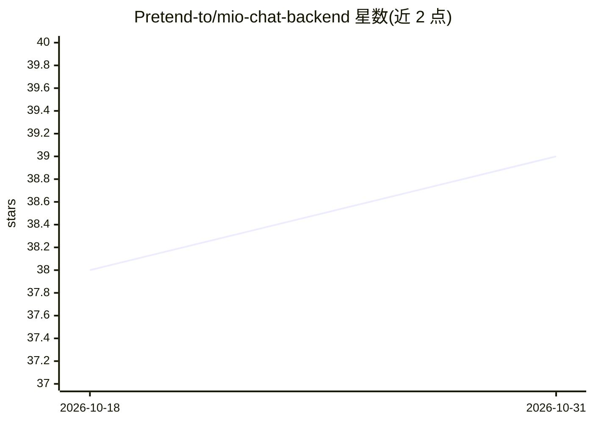

# Pretend-to/mio-chat-backend

⭐ 39 · JavaScript · MIT · 推送 2026-10-30 · [GitHub](https://github.com/Pretend-to/mio-chat-backend) · [官网](https://ai.krumio.com) · 组织维护 · 中文 README

**自托管模型无关的 Agent 运行时：多渠道接入与无人值守长跑**

开源 Agent 运行时（后端仓库），提供 Agent/Session/SubAgent 三级上下文模型、16 个生命周期 Hook 挂载点、MCP 与 Agent Skills 双标准工具生态、插件零停机热插拔。支持 OneBot (QQ) 与微信 iLink 渠道接入、定时任务、多 Agent 混合群组、交互式工具挂起授权。内置 7 种 LLM 适配器（openai/anthropic/gemini/xai 等）与 LiteLLM 模型库同步，配置持久化至 SQLite。通过 git clone + pnpm 安装运行，前端为独立仓库。多渠道功能处于 Beta 阶段。

## 筛选速览

| 维度 | 判定 | 备注 |
|---|---|---|
| AI 角色 | `ai-ecosystem` | LLM/agent 周边工具 |
| 许可风险 | `permissive` | MIT |
| 部署形态 | `library` | 以包/库形式分发 |
| 模型依赖 | locked-api |  |
| 硬件要求 | — | 无带数字的原话,不猜 |
| 安装摩擦 | `low` | 无编译、无系统依赖或容器化 |
| 成熟度 | `idea` | |

## 能力要点

- Agent/Session/SubAgent 三级上下文模型，子 Session 树状隔离
- MCP + Agent Skills 双标准工具生态，插件零停机热插拔
- OneBot (QQ) 与微信 iLink 渠道接入（微信渠道为 Beta）
- 16 个生命周期 Hook 挂载点与敏感工具二次确认挂起

## 适用场景

- 自托管部署多渠道（Web/微信/QQ）接入的 AI Agent 服务
- 让 Agent 通过定时任务与 SubAgent 编排无人值守长跑
- 通过插件/Hook 扩展 Agent 工具并做权限审计

## 场景标签

`多智能体` `聊天机器人` `Agent 框架` · 领域:Agent 开发

## 证据(README 行号)

> L7: 开源的、模型无关的 Agent 运行时：**Agent / Session / SubAgent 三级上下文模型**、V3 Hook 切面、MCP 与 Skills 双标准工具生态、多渠道接入，以及可无人值守长跑的定时自治。
> L169: |LLM 适配器实现|7|openai / openai-responses / anthropic / gemini / gemini-oauth / xai / agent-platform（内含多家 OpenAI 兼容厂商

## 星数曲线

2026-10-18 38 → 2026-10-31 39（+1）

---
*卡片 v1 · prompt 1.4 · 生成 2026-10-25 · 置信度 mid · 依据 README sha `2e2346a2794a` · [字段定义](../../DATASET.md)*
