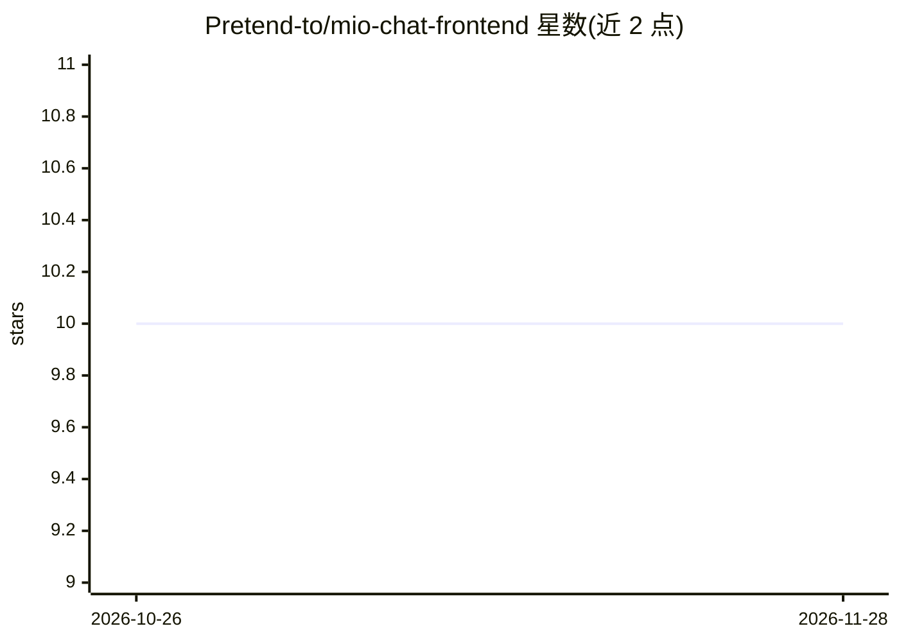

# Pretend-to/mio-chat-frontend

⭐ 10 · Vue · MIT · 推送 2026-11-25 · [GitHub](https://github.com/Pretend-to/mio-chat-frontend) · 个人维护 · 中文 README

**给自托管 Agent 后端提供的多 Agent 群聊前端界面**

MioChat 的前端部分，与 mio-chat-backend 配合组成完整的 Agent 交互系统：提供多 Agent 群组聊天（共享消息链、成员上下文隔离）、工具与技能管理、会话可视化、记忆分区编辑、敏感工具二次确认、定时任务巡检等界面。基于 Vue 3.5 + Vite + Pinia + Element Plus，通过 socket.io 与后端通信，前端还负责客户端上下文工程（system 消息组装、记忆合并）。生产构建产物需托管在后端 Express，需配合后端运行。

## 筛选速览

| 维度 | 判定 | 备注 |
|---|---|---|
| AI 角色 | `ai-ecosystem` | LLM/agent 周边工具 |
| 许可风险 | `permissive` | MIT |
| 部署形态 | `library` | 以包/库形式分发 |
| 模型依赖 | — | README 未给出锁定关系 |
| 硬件要求 | — | 无带数字的原话,不猜 |
| 安装摩擦 | `low` | 无编译、无系统依赖或容器化 |
| 成熟度 | — | 结构信号不足 |

## 能力要点

- 多 Agent 群聊：一条共享消息链，各成员独立组装上下文与视图
- 崩溃安全的流式链路：消息落盘成功才发 ACK，支持重同步
- 客户端记忆工程：可视化查看/编辑五个记忆分区
- 手写 PWA：版本化 Service Worker 与 IndexedDB 响应缓存（7 天 TTL）

## 适用场景

- 为自托管的 Agent 后端搭建网页聊天界面
- 运行和管理多个 Agent 的群组讨论
- 通过网页管理 QQ/OneBot 等多渠道联系人接入
- 在浏览器中查看和编辑 Agent 的长期记忆内容

## 场景标签

`聊天机器人` `多智能体` · 领域:Agent 开发

## 证据(README 行号)

> L10: **自托管 Agent harness 的渲染层。** 另一半在 **mio-chat-backend**。
> L14: 这是 **MioChat** 的前端半壁。它不是聊天皮肤——harness 的上下文工程有一半发生在浏览器里：崩溃安全的流式链路、群聊上下文隔离、客户端记忆组装、Agent 自产 UI，以及一套手写的 PWA 层。
> L86: Vue 3.5 · Vite 8 · Pinia · Element Plus · Socket.io-client · localforage（IndexedDB）· emoji-picker · echarts · mio-p

## 星数曲线

2026-10-26 10 → 2026-11-28 10（+0）

---
*卡片 v1 · prompt 1.4 · 生成 2026-11-20 · 置信度 high · 依据 README sha `e154f4c415e6` · [字段定义](../../DATASET.md)*
