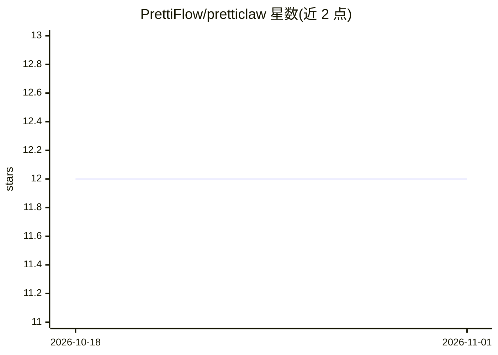

# PrettiFlow/pretticlaw

⭐ 12 · TypeScript · 推送 2026-03-07 · [GitHub](https://github.com/PrettiFlow/pretticlaw) · [官网](https://prettiflow.tech/claw) · 组织维护

**本地运行的轻量 AI 助手/agent 平台，带仪表盘与定时任务**

以 npm CLI 形式发布的 agent 平台：提供 pretticlaw agent 交互对话、gateway 启动 6767 端口的浏览器仪表盘（聊天/频道/cron/状态），支持 OpenAI、Anthropic、Groq、OpenRouter 及任意 OpenAI 兼容端点，均面向 tool-call。内置 cron 定时任务与每 30 分钟心跳机制、exec/读写/搜索等工具，可接入 Telegram/WhatsApp 频道，受 OpenClaw 启发。面向希望在本机长期运行个人 AI 助手的用户。

## 筛选速览

| 维度 | 判定 | 备注 |
|---|---|---|
| AI 角色 | `ai-native` | 本体是模型或模型工具 |
| 许可风险 | `none` | — |
| 部署形态 | `library` | 以包/库形式分发 |
| 模型依赖 | locked-api |  |
| 硬件要求 | — | 无带数字的原话,不猜 |
| 安装摩擦 | `low` | 无编译、无系统依赖或容器化 |
| 成熟度 | — | 结构信号不足 |

## 能力要点

- 多 LLM 供应商支持（OpenAI/Anthropic/Groq/OpenRouter/OpenAI 兼容端点）
- 零样板 CLI 与 6767 端口浏览器仪表盘
- cron 定时任务与 30 分钟心跳自动执行任务
- 可接入 Telegram/WhatsApp 聊天频道

## 适用场景

- 让 AI 全天候监控市场并在早晨生成简报
- 让 agent 读取代码库、编写代码并迭代修 bug
- 通过 Telegram/WhatsApp 随时与个人助手对话
- 定时任务与心跳机制自动执行日常待办

## 场景标签

`AI 助手` · 领域:对话与助手

## 证据(README 行号)

> L24: Pretticlaw is a **minimal yet full-featured** agent platform that ships with:
> L29: - Multi-provider support: OpenAI, Anthropic, Groq, OpenRouter, and more, all tuned for tool-call support.

## 星数曲线

2026-10-18 12 → 2026-11-01 12（+0）

---
*卡片 v1 · prompt 1.4 · 生成 2026-11-01 · 置信度 high · 依据 README sha `6cf679031f47` · [字段定义](../../DATASET.md)*
