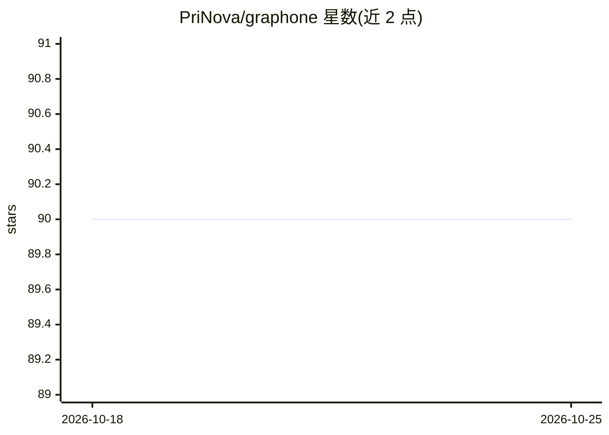

# PriNova/graphone

⭐ 90 · TypeScript · MIT · 推送 2026-06-23 · [GitHub](https://github.com/PriNova/graphone) · 个人维护

**面向 agent 运行的可视化工作台桌面应用（pi 运行时）**

基于 Tauri 2.x 与 Svelte 5 的原生桌面应用，作为 pi 运行时与扩展层之上的人类控制面：提供流式聊天 UI 与工具输出渲染、多会话工作流与侧栏历史、浮动会话窗口，pi sidecar 在 Tauri 构建时自动打包。定位为 artifact 优先的工作区与未来多 agent 环境，而非单一会话 shell。支持 Linux/macOS/Windows 三平台构建（Windows 可从 Linux 交叉编译，提供 NSIS 安装包与便携 exe）。构建需 Node.js 20+、bun 1+、Rust stable 及各平台 Tauri 依赖。

## 筛选速览

| 维度 | 判定 | 备注 |
|---|---|---|
| AI 角色 | `ai-ecosystem` | LLM/agent 周边工具 |
| 许可风险 | `permissive` | MIT |
| 部署形态 | `desktop` | 安装包/桌面程序 |
| 模型依赖 | — | README 未给出锁定关系 |
| 硬件要求 | — | 无带数字的原话,不猜 |
| 安装摩擦 | `low` | 无编译、无系统依赖或容器化 |
| 成熟度 | — | 结构信号不足 |

## 能力要点

- pi 运行时与扩展层之上的可视化 agent 工作台
- 流式聊天 UI、工具输出渲染、多会话与浮动会话窗口
- Linux/macOS/Windows 原生桌面构建，pi sidecar 自动打包
- 平台无关架构：桌面壳、host/service 边界、pi 运行时三层

## 适用场景

- 在桌面端通过聊天界面编排与监控 coding agent 的运行
- 多会话管理 agent 工作流并查看工具输出
- 在 pi 运行时基础上扩展自定义 agent 能力

## 场景标签

`编码 Agent` · 领域:编码与开发

## 证据(README 行号)

> L3: Graphone is a **visual workbench for serious agent work**, with **pi** as the runtime and extensibility substrate un
> L20: - A human control surface over pi-backed runtimes
> L95: Graphone UI -> Graphone host/service boundary -> pi runtime/extensibility layer

## 星数曲线

2026-10-18 90 → 2026-10-25 90（+0）

---
*卡片 v1 · prompt 1.4 · 生成 2026-10-23 · 置信度 high · 依据 README sha `4bc44bc8762e` · [字段定义](../../DATASET.md)*
