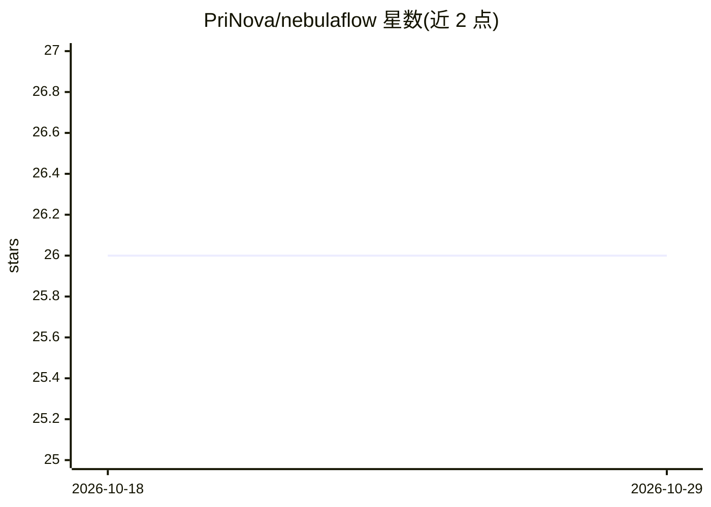

# PriNova/nebulaflow

⭐ 26 · TypeScript · MIT · 推送 2026-07-19 · [GitHub](https://github.com/PriNova/nebulaflow) · [官网](https://prinova.github.io/nebulaflow/) · 个人维护

**面向开发者的可视化工作流节点图编辑器，可运行 LLM 与 CLI 节点**

以节点图形式设计并执行开发者工作流的可视化编辑器，节点类型覆盖 CLI/Shell、LLM、预览、控制流（If/Else、Loop）、子流程与自定义节点。LLM 节点通过 pi coding-agent SDK（PiAgent API）执行，支持对话续写与 read/bash/edit 等 agent 工具，模型发现与认证复用 pi 的配置体系。提供 VS Code 扩展、Electron 桌面应用（自声明 beta）与浏览器三种运行形态，工作流以 JSON 持久化到工作区。Shell 节点含安全黑名单与审批机制。

## 筛选速览

| 维度 | 判定 | 备注 |
|---|---|---|
| AI 角色 | `ai-ecosystem` | LLM/agent 周边工具 |
| 许可风险 | `permissive` | MIT |
| 部署形态 | `desktop` | 安装包/桌面程序 |
| 模型依赖 | — | README 未给出锁定关系 |
| 硬件要求 | — | 无带数字的原话,不猜 |
| 安装摩擦 | `low` | 无编译、无系统依赖或容器化 |
| 成熟度 | `idea` | |

## 能力要点

- LLM 节点经 pi coding-agent SDK 执行，支持线程续写与 pi 工具（read/bash/edit 等）
- CLI/LLM/控制流/子流程/自定义节点等节点类型与图执行引擎
- VS Code 扩展、Electron 桌面（beta）、浏览器 WebSocket 三种部署形态
- 命令模式危险前缀黑名单、命令净化与结构化审批机制

## 适用场景

- 用节点图编排 CLI 与 LLM 混合的开发者工作流
- 在 VS Code 内可视化设计并执行带 agent 工具调用的 LLM 流程
- 把常用节点组合保存为自定义节点或子流程复用

## 场景标签

`工作流自动化` · 领域:效率与自动化

## 证据(README 行号)

> L3: NebulaFlow is a visual editor for designing and running developer workflows as node graphs. It supports VS Code, a s
> L12: The LLM node runs via the pi coding-agent SDK (`@earendil-works/pi-agent-core` + `@earendil-works/pi-ai`). The edit
> L38: - LLM nodes run via the pi coding-agent SDK (`@earendil-works/pi-agent-core`), building prompts from upstream node 

## 星数曲线

2026-10-18 26 → 2026-10-29 26（+0）

---
*卡片 v1 · prompt 1.4 · 生成 2026-10-26 · 置信度 high · 依据 README sha `d891c0461efd` · [字段定义](../../DATASET.md)*
