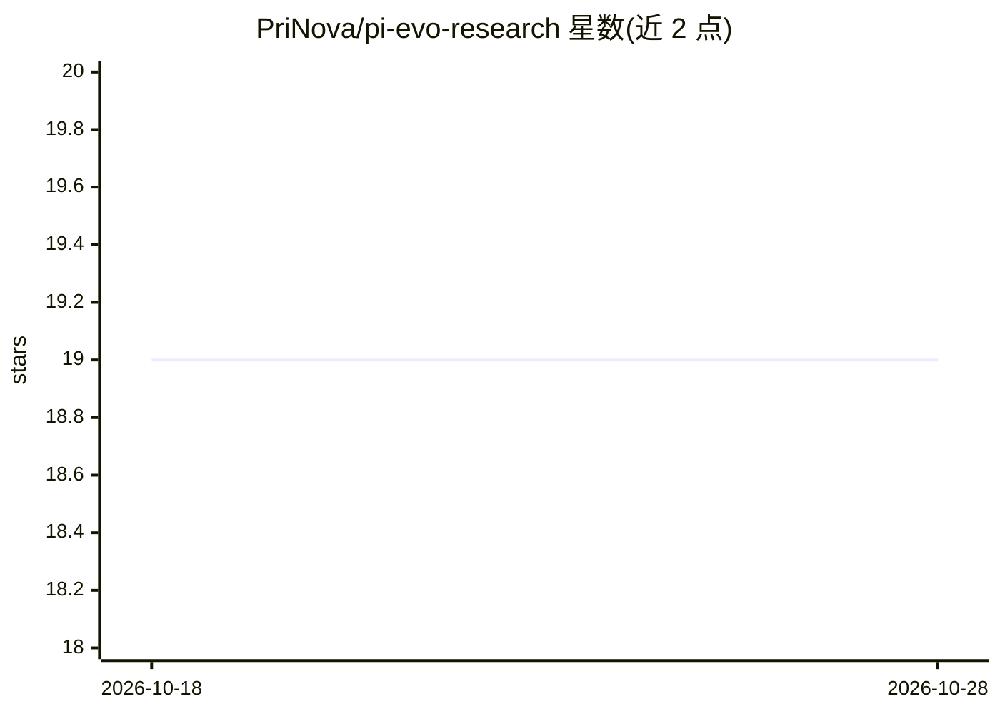

# PriNova/pi-evo-research

⭐ 19 · TypeScript · MIT · 推送 2026-07-29 · [GitHub](https://github.com/PriNova/pi-evo-research) · [官网](https://prinova.de) · 个人维护

**面向 pi 编码代理的种群引导进化研究扩展**

pi 编码代理的扩展与技能包：通过运行基准实验驱动软件开发优化循环，生成候选假设或补丁家族（seed/mutation/recombination/novelty 等 8 种算子），按主指标与置信度保留改进、回退劣化，并维护可持久化的种群状态文件以避免单路径爬山。提供 init/run/log 三个工具、/evo-research 命令、实验日志（evo-research.jsonl）、浏览器仪表盘与可选 before/after hook 脚本。基准命令输出 METRIC 行作为唯一事实来源，种群状态仅指导下一步尝试方向。

## 筛选速览

| 维度 | 判定 | 备注 |
|---|---|---|
| AI 角色 | `ai-ecosystem` | LLM/agent 周边工具 |
| 许可风险 | `permissive` | MIT |
| 部署形态 | `None` |  |
| 模型依赖 | — | README 未给出锁定关系 |
| 硬件要求 | — | 无带数字的原话,不猜 |
| 安装摩擦 | `low` | 无编译、无系统依赖或容器化 |
| 成熟度 | — | 结构信号不足 |

## 能力要点

- 8 种进化算子（seed/mutation/parameter_tune/specialization/simplification/recombination/novelty 等）
- append-only 实验日志与可持久化种群状态（ASI 约定），支持跨会话恢复
- keep/discard 自动化：保留改进并提交，回退被拒绝的改动
- 浏览器实时仪表盘展示运行历史、指标与置信度

## 适用场景

- 让编码代理以基准指标为准自动优化测试速度、包体积或 ML 训练 loss
- 在宽广或嘈杂的优化任务中维持多候选家族、避免局部最优
- 跨会话恢复未完成的优化研究，依赖文件日志而非聊天历史

## 场景标签

`编码 Agent` · 领域:编码与开发

## 证据(README 行号)

> L6: `pi-evo-research` helps a coding agent optimize software by running measured experiments, keeping improvements, disc
> L36: |**Pi extension**|Tools, session state, dashboard, run logging, keep/discard automation|

## 星数曲线

2026-10-18 19 → 2026-10-28 19（+0）

---
*卡片 v1 · prompt 1.4 · 生成 2026-10-28 · 置信度 high · 依据 README sha `8ba5b4cb1b1d` · [字段定义](../../DATASET.md)*
