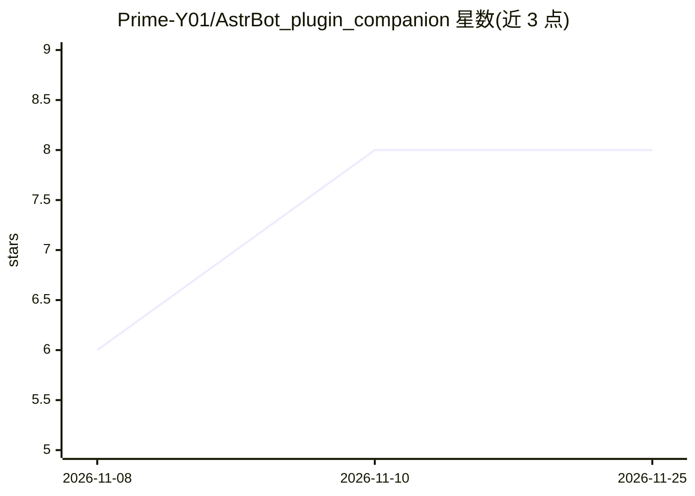

# Prime-Y01/AstrBot_plugin_companion

⭐ 8 · Python · MIT · 推送 2026-11-10 · [GitHub](https://github.com/Prime-Y01/AstrBot_plugin_companion) · 个人维护 · 中文 README

**给 AstrBot AI 伴偶加作息/情绪/记忆状态系统的插件**

作为 AstrBot 插件安装，为 AI 伴偶维护一套本地状态引擎：心跳每分钟推进作息与命令消费，主人私聊更新活动、心情与记忆导出，附独立面板进程展示 3D 记忆星图、实时状态与 7 个白名单指令。支持 plugin（自带引擎）与 external（只读外部状态、写命令队列）两种模式，不调用 LLM、不读群聊、不直连记忆库，记忆文本只存插件数据目录。Windows/Linux 可运行，默认仅监听 127.0.0.1。

## 筛选速览

| 维度 | 判定 | 备注 |
|---|---|---|
| AI 角色 | `ai-enhanced` | 去掉 AI 部分产品仍成立 |
| 许可风险 | `permissive` | MIT |
| 部署形态 | `None` |  |
| 模型依赖 | — | README 未给出锁定关系 |
| 硬件要求 | — | 无带数字的原话,不猜 |
| 安装摩擦 | `low` | 无编译、无系统依赖或容器化 |
| 成熟度 | — | 结构信号不足 |

## 能力要点

- 心跳机制每分钟推进作息与消费白名单命令（睡觉/吃饭/夸她等 7 条）
- 主人私聊驱动状态与 v3 记忆导出，含「第一次」写成长里程碑
- plugin/external 双模式：外部状态只读防双写，按 JSON 契约接入
- 独立面板进程与模拟页，示例数据虚构、不读生产 data 目录

## 适用场景

- 给 AstrBot 上的 AI 伴偶添加作息、情绪与记忆状态
- 本地只读面板查看伴偶的实时活动与记忆星图
- 按数据契约把面板接入自己已有的伴偶 bot 状态目录

## 场景标签

`聊天机器人` `Agent 记忆` · 领域:Agent 开发

## 证据(README 行号)

> L5: 一个独立的「予其真实」面板，加上一套轻量的状态引擎。装进 AstrBot 后：
> L202: 不调用 LLM、不读群聊、不直连 `livingmemory.db`。记忆文本只存在自己的 `plugin_data`；面板上镜模式会遮。

## 星数曲线

2026-11-08 6 → 2026-11-25 8（+2）

---
*卡片 v1 · prompt 1.4 · 生成 2026-11-20 · 置信度 mid · 依据 README sha `c5cf21adae29` · [字段定义](../../DATASET.md)*
