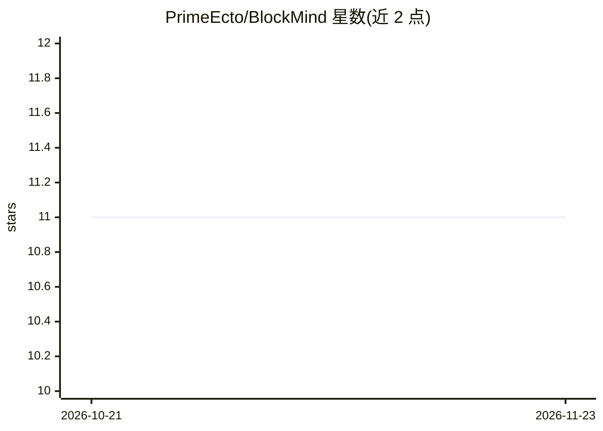

# PrimeEcto/BlockMind

⭐ 11 · TypeScript · 推送 2026-09-03 · [GitHub](https://github.com/PrimeEcto/BlockMind) · [官网](https://www.blockmind.online/) · 个人维护

**让 AI agent 经 MCP 管理 Minecraft 服务器的连接器与面板**

BlockMind 提供 MCP（Model Context Protocol）连接器，使 Claude Code、Cursor 等兼容客户端可读取控制台日志、编辑文件、修改启动变量、执行启停重启与崩溃排查。使用方式两种：托管面板（免费账户，3 台服务器/月 5000 次 AI 操作，密钥 AES-256-GCM 加密存储）或自托管 Cloudflare Workers。连接器无状态、不存数据库；破坏性操作需显式确认；支持 18 家主机及自托管 Agent，Multicraft 类主机无文件工具。

## 筛选速览

| 维度 | 判定 | 备注 |
|---|---|---|
| AI 角色 | `ai-enhanced` | 去掉 AI 部分产品仍成立 |
| 许可风险 | `none` | — |
| 部署形态 | `library` | 以包/库形式分发 |
| 模型依赖 | — | README 未给出锁定关系 |
| 硬件要求 | — | 无带数字的原话,不猜 |
| 安装摩擦 | `low` | 无编译、无系统依赖或容器化 |
| 成熟度 | — | 结构信号不足 |

## 能力要点

- MCP 连接器支持 Claude Code/Cline/Cursor/VS Code/Codex 等客户端
- 18 家主机适配（Pterodactyl/exaroton/Multicraft/DatHost/Nitrado）及自托管路径
- 工具分只读与受保护两类，破坏性操作需显式确认
- 连接器无状态，provider API key 随请求传递后即被丢弃

## 适用场景

- 在聊天客户端里让 AI agent 查看 Minecraft 服务器日志并排查崩溃
- 通过对话执行服务器启停、发送命令等管理操作
- 用一个面板统一管理多家主机的服务器状态与文件

## 场景标签

 · 领域:游戏服务器管理/AI 工具生态

## 证据(README 行号)

> L1: BlockMind — universal Minecraft server control: one dashboard for hosted and self-hosted servers, with optional MCP 
> L23: Dashboard reads go directly from the site to your host and **never** consume AI operations — only AI calls through 

## 星数曲线

2026-10-21 11 → 2026-11-23 11（+0）

---
*卡片 v1 · prompt 1.4 · 生成 2026-11-18 · 置信度 mid · 依据 README sha `8f05e09a2e33` · [字段定义](../../DATASET.md)*
