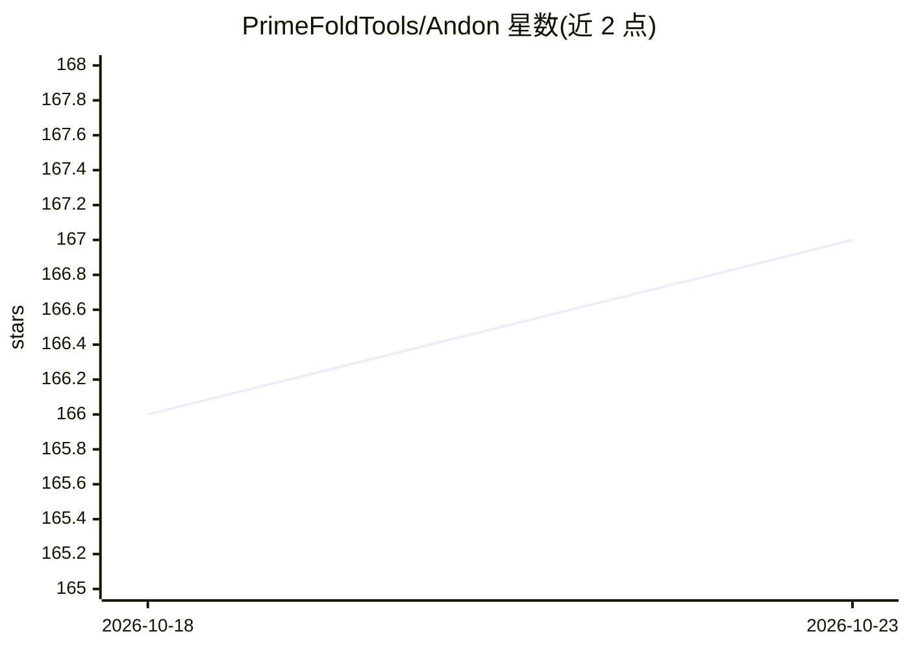

# PrimeFoldTools/Andon

⭐ 167 · Python · MIT · 推送 2026-10-22 · [GitHub](https://github.com/PrimeFoldTools/Andon) · 个人维护

**面向 AI agent 协作的精益质量体系工具包：把缺陷转为防错机制**

由制造业操作员个人维护的开源操作套件，将丰田生产系统（Andon/Poka-yoke/Kaizen）纪律移植到 AI 辅助开发中。内容为纯 Markdown 模板加少量仅依赖标准库的 Python 脚本（claim-check 与 auto-orient 两个 hook）：Layer 1 提供结构化记忆文件缓解 agent 遗忘；Layer 3 的 Stop hook 在回合结束时检测完成声明并核验同会话验证记录，默认 warn 模式。README 详细列出了已知绕过路径与局限，包括 agent 伪造记录、命令行语法绕过等。

## 筛选速览

| 维度 | 判定 | 备注 |
|---|---|---|
| AI 角色 | `ai-ecosystem` | LLM/agent 周边工具 |
| 许可风险 | `permissive` | MIT |
| 部署形态 | `None` |  |
| 模型依赖 | — | README 未给出锁定关系 |
| 硬件要求 | — | 无带数字的原话,不猜 |
| 安装摩擦 | `low` | 无编译、无系统依赖或容器化 |
| 成熟度 | — | 结构信号不足 |

## 能力要点

- claim-check hook 检测完成声明并核验验证条目，拦截虚假 done
- 四层渐进结构：记忆文件→CLAUDE.md 指令→hook→操作者系统
- DEFECT_LEDGER.md 记录缺陷→根因→对策→结果
- 仅 Markdown + 标准库 Python 脚本，无依赖、无账号

## 适用场景

- 让 AI agent 跨会话记住项目决策与约定
- 拦截 agent 未验证即宣称完成的回合
- 以缺陷台账方式积累并防错 agent 反复犯的错误

## 场景标签

`Agent 记忆` · 领域:Agent 开发

## 证据(README 行号)

> L108: |**3 — The hooks**|claim-check (catches false "done") + auto-orient (loads memory at start)|30 min|False "done" + 
> L116: - **Opt-in: evidence from the harness, not the agent (`CLAIM_CHECK_EVIDENCE=tool`).** Instead of the agent's own l

## 星数曲线

2026-10-18 166 → 2026-10-23 167（+1）

---
*卡片 v1 · prompt 1.4 · 生成 2026-10-23 · 置信度 high · 依据 README sha `ca65511efbbd` · [字段定义](../../DATASET.md)*
