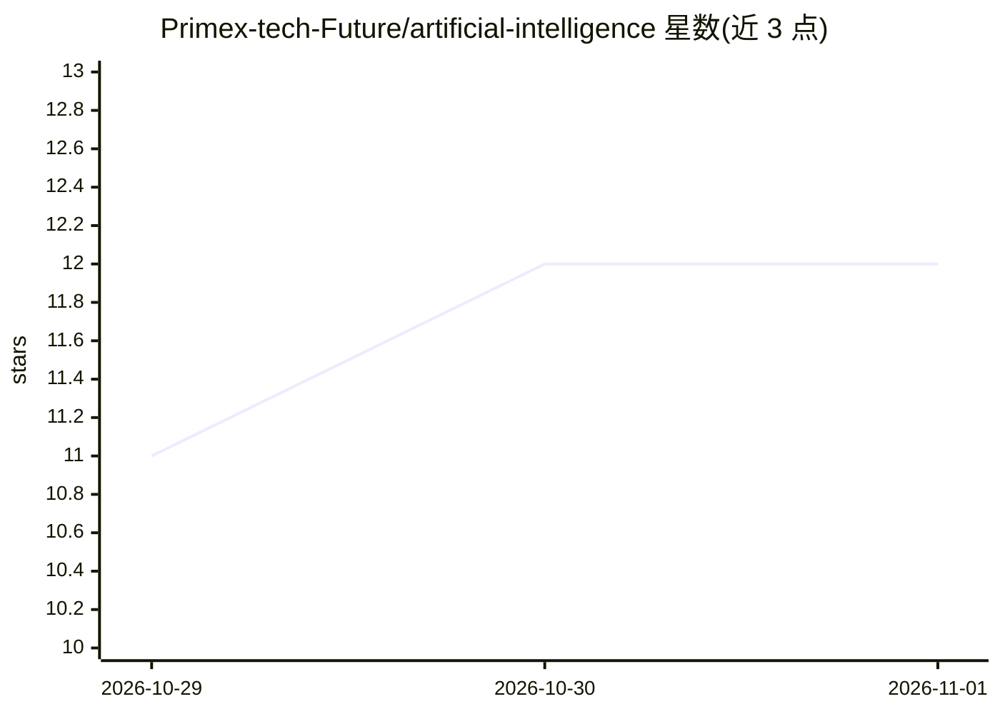

# Primex-tech-Future/artificial-intelligence

⭐ 12 · Python · MIT · 推送 2026-10-27 · [GitHub](https://github.com/Primex-tech-Future/artificial-intelligence) · 组织维护

**面向 Stellar/Soroban 生态的 LLM 分析服务与 TypeScript SDK**

Monorepo 包含两部分：Python 侧是 stellar-ai，基于 FastAPI 的服务与 agent 核心，读取 Stellar Horizon 与 Soroban RPC 数据，产出 LLM 驱动的网络健康摘要、合约事件解码、自然语言问答、鲸鱼转账提醒与账本异常检测；TypeScript 侧提供类型化客户端 SDK @optimus-primex/ai-client。LLM 提供者有两种：离线确定性 static 桩与任意 OpenAI 兼容 /chat/completions 端点的 openai 提供者。自述为早期框架，异常检测中的 anomaly detection 为下一里程碑。支持 Docker 与 Python 3.11+。

## 筛选速览

| 维度 | 判定 | 备注 |
|---|---|---|
| AI 角色 | `ai-native` | 本体是模型或模型工具 |
| 许可风险 | `permissive` | MIT |
| 部署形态 | `self-host` | docker 或自建部署 |
| 模型依赖 | local-ok | 支持本地模型 |
| 硬件要求 | — | 无带数字的原话,不猜 |
| 安装摩擦 | `low` | 无编译、无系统依赖或容器化 |
| 成熟度 | `idea` | |

## 能力要点

- 读取 Horizon/Soroban RPC 并生成 LLM 摘要与自然语言问答（/api/v1/chat）
- Soroban 合约事件 base64 XDR 解码与摘要（已在测试网 escrow 合约验证）
- 确定性账本异常 flags 与鲸鱼转账扫描，阈值经环境变量配置
- 两种 LLM 提供者：离线 static 桩与 OpenAI 兼容端点（可指向本地 vLLM/Ollama 网关）

## 适用场景

- 为 Stellar 应用接入 AI 网络健康分析与合约事件解读
- 在 dapp 中通过 TypeScript SDK 提问链上数据
- 监控测试网/主网的账本延迟与鲸鱼大额转账

## 场景标签

`数据分析` · 领域:效率与自动化

## 证据(README 行号)

> L12: - **`python/`** — `stellar-ai`, a FastAPI service and agent core that reads
> L13:  Stellar Horizon and Soroban RPC data and produces LLM-powered analysis.
> L19: > `static` stub (used by tests/CI) and an `openai` provider for any

## 星数曲线

2026-10-29 11 → 2026-11-01 12（+1）

---
*卡片 v1 · prompt 1.4 · 生成 2026-11-01 · 置信度 high · 依据 README sha `bd119cc1cfa4` · [字段定义](../../DATASET.md)*
