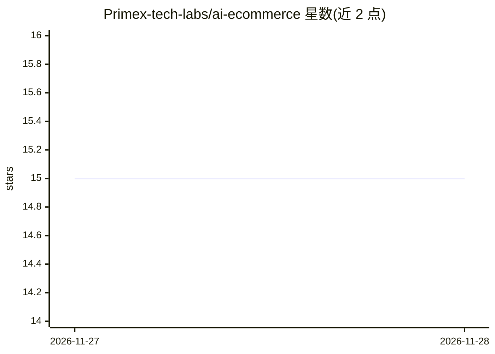

# Primex-tech-labs/ai-ecommerce

⭐ 15 · TypeScript · MIT · 推送 2026-11-26 · [GitHub](https://github.com/Primex-tech-labs/ai-ecommerce) · 个人维护

**面向开发者的 AI 辅助电商店面前端框架（含链上托管结算）**

开源框架，用于构建带 AI 助手与链上结算的电商店面：Next.js 店面（目录/购物车/结账/AI 购物助手/订单面板）、FastAPI AI 服务（聊天/推荐/关键词搜索，LLM 可插拔）、Stellar/Soroban 托管合约与事件 indexer，Turborepo+pnpm 工作区组织。默认离线 stub 提供者无需 API key；可选 PostgreSQL 持久化与账户登录，未配置时回退 JSON 订单存储。项目自述尚未达到生产可用。

## 筛选速览

| 维度 | 判定 | 备注 |
|---|---|---|
| AI 角色 | `ai-enhanced` | 去掉 AI 部分产品仍成立 |
| 许可风险 | `permissive` | MIT |
| 部署形态 | `self-host` | docker 或自建部署 |
| 模型依赖 | local-ok | 支持本地模型 |
| 硬件要求 | — | 无带数字的原话,不猜 |
| 安装摩擦 | `low` | 无编译、无系统依赖或容器化 |
| 成熟度 | `idea` | |

## 能力要点

- 可插拔 LLM 提供者：OpenAI/Anthropic/本地模型/离线 stub
- Stellar/Soroban 托管合约结算，含买家放款/卖家退款与仲裁人争议流程
- indexer 通过 HMAC 签名 webhook 向订单存储推送链上事件
- Playwright 端到端测试与 Vitest/合约测试，CI 上传失败产物

## 适用场景

- 搭建带 AI 购物助手的电商店面前端
- 用 Stellar 托管合约实现买卖双方的订单资金托管与争议仲裁
- 本地无 API key 环境下用 stub 提供者开发测试店面流程

## 场景标签

 · 领域:电商/区块链

## 证据(README 行号)

> L5: An open-source framework for building **AI-assisted ecommerce storefronts with on-chain
> L9: - Storefront with catalog, cart, checkout, an AI shopping assistant, and an orders
> L22: - **AI service** (`apps/ai-service`) - FastAPI app exposing chat, recommendations, and

## 星数曲线

2026-11-27 15 → 2026-11-28 15（+0）

---
*卡片 v1 · prompt 1.4 · 生成 2026-11-27 · 置信度 high · 依据 README sha `6fa20b2c9894` · [字段定义](../../DATASET.md)*
