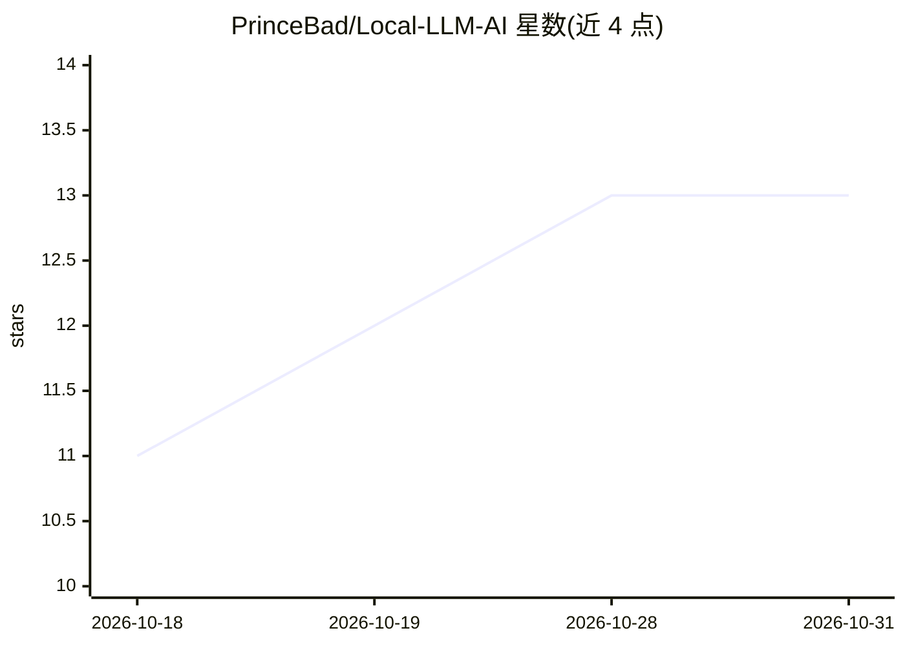

# PrinceBad/Local-LLM-AI

⭐ 13 · Kotlin · MIT · 推送 2026-10-26 · [GitHub](https://github.com/PrinceBad/Local-LLM-AI) · [官网](https://github.com/PrinceBad/Local-LLM-AI/releases) · 个人维护

**在 Android 设备上离线运行大语言模型的多模态聊天客户端**

基于 Google AI Edge LiteRT-LM 引擎与 Jetpack Compose 构建的 Android 应用，在本地硬件上编译并运行 Qwen、DeepSeek-R1、Gemma 等轻量级 LLM，提供流式对话、多会话管理、推理过程折叠显示。执行采用三级降级：高通 Hexagon NPU（QNN HTP）→ Vulkan GPU →大核 CPU。支持 100% 离线的图像 OCR（ML Kit）、PDF 逐页渲染、视频关键帧抽取等多模态输入，模型权重不打包在 APK 内，需手动下载（1.5 GB+），建议 6 GB+ RAM 与较新处理器。以 GitHub Releases 的 APK 分发，也可用 JDK 17 与 Android SDK 自行编译。

## 筛选速览

| 维度 | 判定 | 备注 |
|---|---|---|
| AI 角色 | `ai-native` | 本体是模型或模型工具 |
| 许可风险 | `permissive` | MIT |
| 部署形态 | `desktop` | 安装包/桌面程序 |
| 模型依赖 | — | README 未给出锁定关系 |
| 硬件要求 | — | 无带数字的原话,不猜 |
| 安装摩擦 | `medium` | 含编译或系统依赖之一 |
| 成熟度 | — | 结构信号不足 |

## 能力要点

- 三级执行降级：Qualcomm Hexagon NPU → Vulkan GPU → 大核 CPU
- 内置 10 个轻量模型预设（0.6B–4B，含多模态视觉模型）
- 离线 OCR、PDF 渲染与视频关键帧抽取的多模态输入管线
- 实时硬件遥测：首 token 延迟（ms）与解码速度（tokens/sec）

## 适用场景

- 在无网络环境下用手机本地与大语言模型对话
- 离线识别图片、PDF 与视频中的文字内容
- 在支持的骁龙设备上利用 NPU 加速推理
- 运行 DeepSeek-R1 蒸馏模型做离线推理链思考

## 场景标签

`聊天机器人` `OCR` `多模态` · 领域:对话与助手

## 证据(README 行号)

> L20: Local LLM/AI is a high-fidelity, modern Android client designed to provide a completely private, offline, and secur
> L24: The app wraps this powerful local engine in a premium, fluid Jetpack Compose (Material 3) user interface featuring 

## 星数曲线

2026-10-18 11 → 2026-10-31 13（+2）

---
*卡片 v1 · prompt 1.4 · 生成 2026-10-31 · 置信度 high · 依据 README sha `9b0f48c75633` · [字段定义](../../DATASET.md)*
