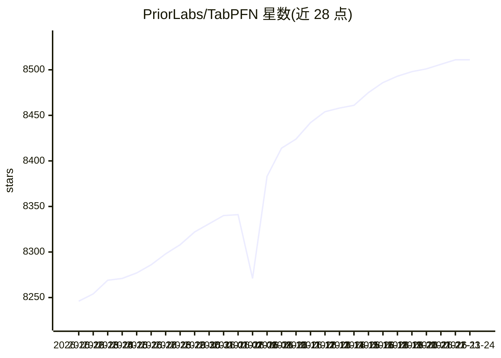

# PriorLabs/TabPFN

⭐ 8,511 · Python · Apache-2.0 · 推送 2026-11-22 · [GitHub](https://github.com/PriorLabs/TabPFN) · [官网](http://priorlabs.ai) · 组织维护

**表格数据基础模型：无需训练即可分类回归预测**

TabPFN 是在合成数据上预训练的表格数据基础模型，对未见过的真实数据集以单次前向传播完成分类与回归。以 Python 包形式提供 TabPFNClassifier/TabPFNRegressor，支持多个模型版本（TabPFN-3.5、3.5-Fast、3 等），推荐规模上限 100 万行、2 万特征。推荐 GPU 运行，CPU 仅适合中等规模数据；也提供云端推理客户端 TabPFN Client。首次使用需登录 PriorLabs 接受许可条款以下载模型权重，之后可离线运行。代码采用 Apache 2.0 许可，另有面向生产环境的付费 Enterprise Edition。

## 筛选速览

| 维度 | 判定 | 备注 |
|---|---|---|
| AI 角色 | `ai-native` | 本体是模型或模型工具 |
| 许可风险 | `permissive` | Apache-2.0 |
| 部署形态 | `library` | 以包/库形式分发 |
| 模型依赖 | — | README 未给出锁定关系 |
| 硬件要求 | `gpu-8g` | |
| 安装摩擦 | `medium` | 含编译或系统依赖之一 |
| 成熟度 | — | 结构信号不足 |

## 能力要点

- 单次前向传播完成表格分类与回归，无需常规训练流程
- 多模型版本可选（TabPFN-3.5 / 3.5-Fast / 3 / 2.5 / 2.6）
- 提供云端推理客户端与无代码图形界面 TabPFN UX
- 扩展包支持 SHAP 可解释性、异常检测、嵌入提取、多分类

## 适用场景

- 在不写训练代码的情况下对表格数据做分类或回归
- CPU 或本地 GPU 环境下快速获得表格预测结果
- 为下游任务提取表格数据的内部嵌入表示
- 通过图形界面让业务人员试用表格预测能力

## 场景标签

`数据分析` · 领域:效率与自动化

## 证据(README 行号)

> L10: TabPFN trains on synthetic datasets and predicts on unseen real-world datasets in a single forward pass
> L12: TabPFN-3.5 architecture: a distribution embedder, then row-wise and cross-row attention, read out as per-row tokens
> L49: from tabpfn import TabPFNClassifier, TabPFNRegressor

## 星数曲线

2026-10-22 8,246 → 2026-11-24 8,511（+265）

---
*卡片 v1 · prompt 1.4 · 生成 2026-11-22 · 置信度 high · 依据 README sha `dca997c630ef` · [字段定义](../../DATASET.md)*
