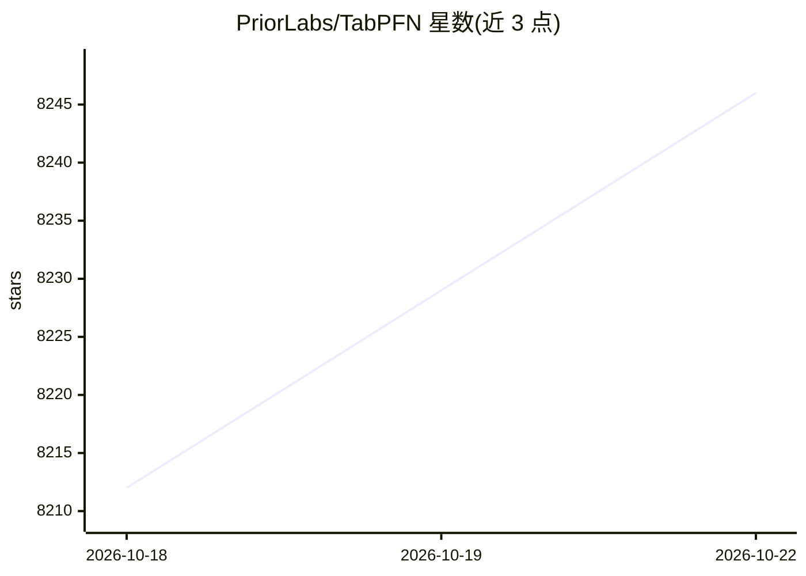

# PriorLabs/TabPFN

⭐ 8,254 · Python · Apache-2.0 · 推送 2026-10-22 · [GitHub](https://github.com/PriorLabs/TabPFN) · [官网](http://priorlabs.ai) · 组织维护

**面向表格数据的预训练基础模型：单次前向传播完成分类与回归预测**

TabPFN 是 PriorLabs 维护的表格数据基础模型 Python 库，提供 TabPFNClassifier 与 TabPFNRegressor：模型在合成数据上预训练，对未见过的真实数据集无需常规训练流程，单次前向传播即可预测。当前默认 TabPFN-3.5 支持至多 100 万行、2 万特征。推荐 GPU（约 8GB VRAM 可用，部分大数据需 16GB），CPU 仅支持中等规模数据；也提供免费托管推理的 TabPFN Client。首次使用需登录 PriorLabs 接受许可下载权重，之后可离线运行。附带社区扩展包（可解释性、离群检测、嵌入提取等）。

## 筛选速览

| 维度 | 判定 | 备注 |
|---|---|---|
| AI 角色 | `ai-native` | 本体是模型或模型工具 |
| 许可风险 | `permissive` | Apache-2.0 |
| 部署形态 | `library` | 以包/库形式分发 |
| 模型依赖 | — | README 未给出锁定关系 |
| 硬件要求 | `gpu-8g` | |
| 安装摩擦 | `medium` | 含编译或系统依赖之一 |
| 成熟度 | — | 结构信号不足 |

## 能力要点

- 单次前向传播完成表格数据分类/回归，无需逐数据集训练
- TabPFN-3.5 支持至多 1,000,000 行 × 20,000 特征
- 支持 CUDA/ROCm/Apple Silicon MPS，权重下载后可离线运行
- 社区扩展包提供 SHAP 可解释性、离群检测、嵌入提取等

## 适用场景

- 中小规模表格数据上直接做分类或回归预测，跳过训练调参流程
- 无 GPU 时通过托管推理或 CPU 模式跑中等规模数据集
- 提取模型嵌入或 SHAP 解释用于下游分析与特征选择

## 场景标签

 · 领域:机器学习/表格数据

## 证据(README 行号)

> L10: TabPFN trains on synthetic datasets and predicts on unseen real-world datasets in a single forward pass
> L49: from tabpfn import TabPFNClassifier, TabPFNRegressor

## 星数曲线

2026-10-18 8,212 → 2026-10-22 8,246（+34）

---
*卡片 v1 · prompt 1.4 · 生成 2026-10-20 · 置信度 high · 依据 README sha `10a9bae18fd8` · [字段定义](../../DATASET.md)*
