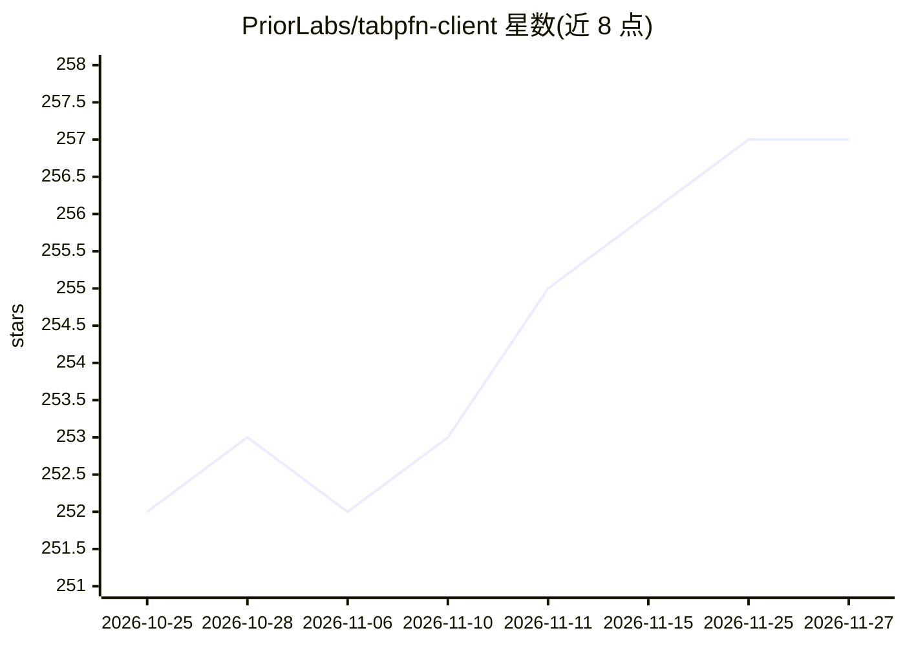

# PriorLabs/tabpfn-client

⭐ 257 · Python · Apache-2.0 · 推送 2026-11-26 · [GitHub](https://github.com/PriorLabs/tabpfn-client) · [官网](https://www.priorlabs.ai) · 组织维护

**为数据科学者提供表格基础模型 TabPFN 的云 API 客户端**

该库是 TabPFN 表格基础模型的 Python API 客户端，通过云端服务器完成分类与回归的 fit/predict。核心机制：token 认证、thinking mode（以更长 fit 时间换取预测质量，含 effort 等级、超时、分组/时间列等参数）、KV cache 复用拟合结果、fitted model 的保存/加载与跨机器预测、异步 submit_fit/submit_predict 流程、服务端耗时报告与回归分布绘图。限制：数据会上传至其服务器，禁止上传敏感信息；thinking mode 仅支持 v3 模型且有每日次数预算。

## 筛选速览

| 维度 | 判定 | 备注 |
|---|---|---|
| AI 角色 | `ai-native` | 本体是模型或模型工具 |
| 许可风险 | `permissive` | Apache-2.0 |
| 部署形态 | `library` | 以包/库形式分发 |
| 模型依赖 | — | README 未给出锁定关系 |
| 硬件要求 | — | 无带数字的原话,不猜 |
| 安装摩擦 | `low` | 无编译、无系统依赖或容器化 |
| 成熟度 | — | 结构信号不足 |

## 能力要点

- sklearn 风格的 TabPFNClassifier/TabPFNRegressor 云端分类与回归
- thinking mode：多档 effort、超时、group/time 列约束与独立每日预算
- fitted model 保存/加载，可跨进程与跨机器复用拟合结果
- submit_fit/wait_for_fit、submit_predict/wait_for_predict 异步流程

## 适用场景

- 在表格数据上快速跑分类/回归基线，不需本地部署模型
- fit 开销大的任务把拟合结果保存后在其他机器上直接预测
- 长耗时 thinking mode 拟合用异步提交与轮询等待管理

## 场景标签

`数据分析` · 领域:效率与自动化

## 证据(README 行号)

> L12: TabPFN is a foundation model for tabular data that outperforms traditional methods while being dramatically faster.
> L33: - **TabPFN Client (this repo)**: Easy-to-use API client for cloud-based inference
> L25: This is a cloud-based service: your data will be sent to our servers for processing.

## 星数曲线

2026-10-25 252 → 2026-11-27 257（+5）

---
*卡片 v1 · prompt 1.4 · 生成 2026-11-25 · 置信度 high · 依据 README sha `6beb6c5e8ebb` · [字段定义](../../DATASET.md)*
