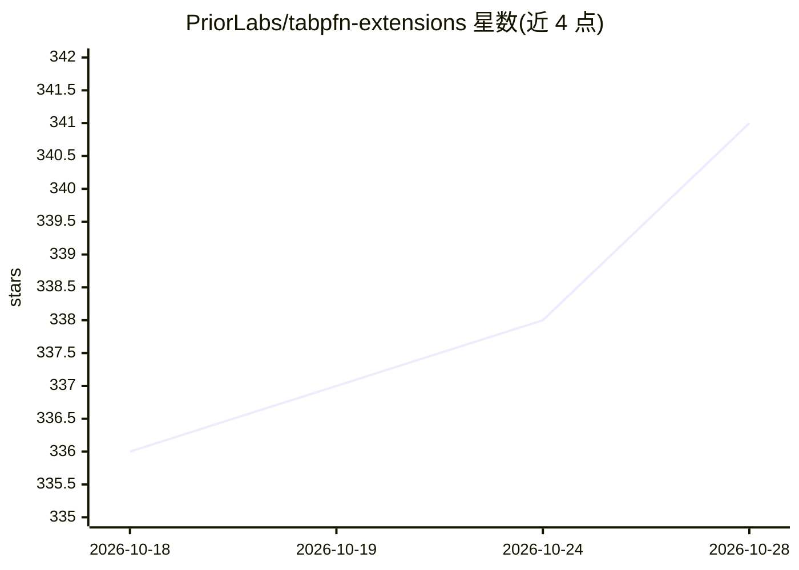

# PriorLabs/tabpfn-extensions

⭐ 341 · Python · Apache-2.0 · 推送 2026-10-21 · [GitHub](https://github.com/PriorLabs/tabpfn-extensions) · [官网](https://www.priorlabs.ai) · 组织维护

**TabPFN 表格基础模型的社区扩展库：可解释性、贝叶斯优化等**

围绕 TabPFN（表格数据基础模型）的社区扩展集合，以 Python 包形式发布，含 8 个扩展模块：SHAP 解释与特征选择、多类分类扩展、数据生成与离群检测、内部样本嵌入、图像列经 DINOv3 转为特征、TabEBM 数据增强、p 值特征检验、以 TabPFN 为代理模型的贝叶斯优化。支持本地 PyTorch 推理与云端 Client 两种后端（embedding 与 bayesian_optimization 仅限本地包）。README 声明扩展为实验性代码，测试不及核心库严格，API 可能无预警变更。

## 筛选速览

| 维度 | 判定 | 备注 |
|---|---|---|
| AI 角色 | `ai-ecosystem` | LLM/agent 周边工具 |
| 许可风险 | `permissive` | Apache-2.0 |
| 部署形态 | `library` | 以包/库形式分发 |
| 模型依赖 | — | README 未给出锁定关系 |
| 硬件要求 | — | 无带数字的原话,不猜 |
| 安装摩擦 | `low` | 无编译、无系统依赖或容器化 |
| 成熟度 | `idea` | |

## 能力要点

- 8 个扩展：解释性、多类、无监督、嵌入、图像列、TabEBM 增强、p 值检验、贝叶斯优化
- 图像列经冻结 DINOv3 转为表格特征供 TabPFN 使用
- 本地 tabpfn 与云端 tabpfn-client 双后端可选
- examples/ 目录提供可运行脚本与 notebook，并有 Colab 交互教程

## 适用场景

- 给 TabPFN 分类/回归结果做 SHAP 解释与特征选择
- 处理超出 checkpoint 类数上限的多类分类任务
- 用 TabPFN 做代理模型执行贝叶斯优化
- 把图像数据嵌入表格后交给 TabPFN 建模

## 场景标签

`数据分析` · 领域:效率与自动化

## 证据(README 行号)

> L36: - **interpretability**: Explain TabPFN predictions with SHAP values and feature selection
> L51: 1. **TabPFN Package** — Full PyTorch implementation for local inference:
> L63: Exceptions to this are **embedding** and **bayesian_optimization**, which only work with the local `tabpfn` package

## 星数曲线

2026-10-18 336 → 2026-10-28 341（+5）

---
*卡片 v1 · prompt 1.4 · 生成 2026-10-21 · 置信度 high · 依据 README sha `eff72fcbaf8f` · [字段定义](../../DATASET.md)*
