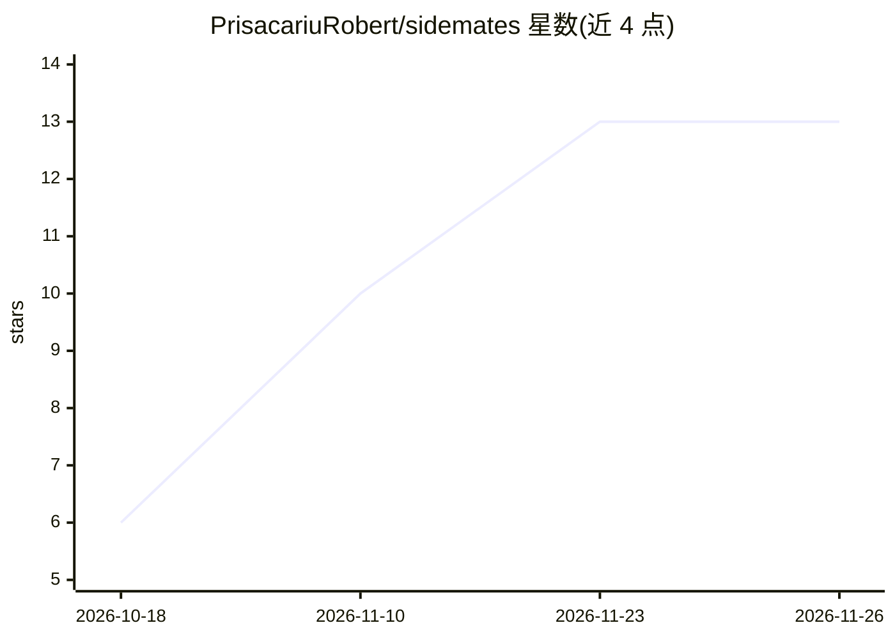

# PrisacariuRobert/sidemates

⭐ 13 · TypeScript · MIT · 推送 2026-11-02 · [GitHub](https://github.com/PrisacariuRobert/sidemates) · [官网](https://openbots.foundation) · 个人维护

**Mac 本地多 AI 队友应用：代操作 Mail/Calendar/浏览器并先请示**

macOS 上的开源 AI 助手团队应用：多个命名队友各自拥有私有工作区与浏览器，可读取本地文件、操作 Mail/Calendar/Notes、执行网页长任务与定时例程；有后果的操作默认停下并显示目标按钮等待确认，可按队友开启 Autopilot（仍对登录/CAPTCHA/新增支出等停止）。接入方式为使用用户已有的 ChatGPT/Grok/Copilot 订阅、Claude Code、Gemini key 或本地模型。提供一行安装脚本与源码运行，依赖 Docker 支持私有电脑环境，MIT 许可，状态为公开 beta。

## 筛选速览

| 维度 | 判定 | 备注 |
|---|---|---|
| AI 角色 | `ai-native` | 本体是模型或模型工具 |
| 许可风险 | `permissive` | MIT |
| 部署形态 | `None` |  |
| 模型依赖 | local-ok | 支持本地模型 |
| 硬件要求 | — | 无带数字的原话,不猜 |
| 安装摩擦 | `low` | 无编译、无系统依赖或容器化 |
| 成熟度 | `idea` | |

## 能力要点

- 多名命名队友协作：各有私有工作区与独立浏览器，按序接力任务
- 行动前确认机制：默认显示目标网站与按钮等待批准，Autopilot 仍保留硬停止项
- 多模型接入：ChatGPT/Grok/Copilot 订阅、Claude Code、Gemini key、OpenAI 兼容 API 或本地 Ollama
- 支持例程定时任务、语音/手机控制、技能教学与一键导入 Hermes Agent/OpenClaw

## 适用场景

- 让 AI 队友在本地 Mail/Calendar/Notes 中代为查邮件、整理日程
- 让队友带来源地做网络调研并复核结果
- 设置每周例程自动规划一周工作
- 不想订阅云端 agent，用已有模型账号在本地跑自动化任务

## 场景标签

`多智能体` `浏览器自动化` `AI 助手` · 领域:Agent 开发

## 证据(README 行号)

> L6:  A small team of AI teammates on your Mac. They work in your own Mail, Calendar and Notes — and ask before anything 
> L31: - **You stay in charge.** Reading and searching just happen. Sending, buying, signing in or submitting waits for yo
> L65: - **Research with sources** — each teammate browses in its own private browser and links what it found; when someth

## 星数曲线

2026-10-18 6 → 2026-11-26 13（+7）

---
*卡片 v1 · prompt 1.4 · 生成 2026-11-20 · 置信度 high · 依据 README sha `c6dbba1c397a` · [字段定义](../../DATASET.md)*
