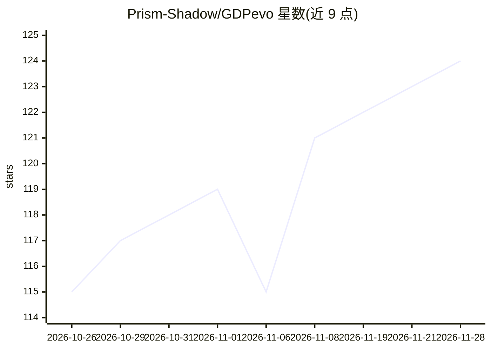

# Prism-Shadow/GDPevo

⭐ 124 · Python · Apache-2.0 · 推送 2026-10-29 · [GitHub](https://github.com/Prism-Shadow/GDPevo) · [官网](https://prism-shadow.github.io/GDPevo/) · 组织维护 · 中文 README

**评测 agent 自进化能力的真实业务任务基准（240 任务）**

公开基准数据集：覆盖 CRM、ERP、金融、医疗、法律、数据分析与工程运维的 24 个任务组共 240 个任务，每组含共享业务环境、5 个训练任务与 5 个留出测试任务；配套规则化评分器与三阶段数据构建工作流（场景发现、任务组合成、质量过滤）。仓库同时发布 base/self/fewshot/reflect-3 四种演化模式在 Codex 与 Claude Code 两种 harness 上的多轮评测结果与逐任务报告，数据构建与评分阶段按 Codex 工作流编写，其他 agent 框架复用需适配。

## 筛选速览

| 维度 | 判定 | 备注 |
|---|---|---|
| AI 角色 | `ai-knowledge` | 知识聚合/清单类 |
| 许可风险 | `permissive` | Apache-2.0 |
| 部署形态 | `None` |  |
| 模型依赖 | — | README 未给出锁定关系 |
| 硬件要求 | — | 无带数字的原话,不猜 |
| 安装摩擦 | `low` | 无编译、无系统依赖或容器化 |
| 成熟度 | — | 结构信号不足 |

## 能力要点

- 240 个真实业务任务、24 个任务组，含训练/留出测试划分与参考答案
- 四条自进化管线对比：base、self、fewshot、reflect-3
- 三阶段 agent-ready 数据构建工作流（含中文镜像）
- 规则化评分器与逐任务评测报告随数据发布

## 适用场景

- 评测 agent 框架在真实业务任务上的自进化效果
- 复用三阶段工作流构建领域评测任务组
- 查阅不同模型/harness 组合的准确率、轮次与成本数据

## 场景标签

`模型评测` · 领域:评测与运维

## 证据(README 行号)

> L12: **GDPevo** is a public benchmark for evaluating agent self-evolution on real business work. The data release contai
> L52: |`data/`|Released benchmark data, including task groups, shared environments, train/test tasks, reference answers, 
> L64: - Stages 1-3 are written for Codex workflows. Other agent frameworks can reuse the same structure, but may need lig

## 星数曲线

2026-10-26 115 → 2026-11-28 124（+9）

---
*卡片 v1 · prompt 1.4 · 生成 2026-11-28 · 置信度 high · 依据 README sha `f629405edecc` · [字段定义](../../DATASET.md)*
