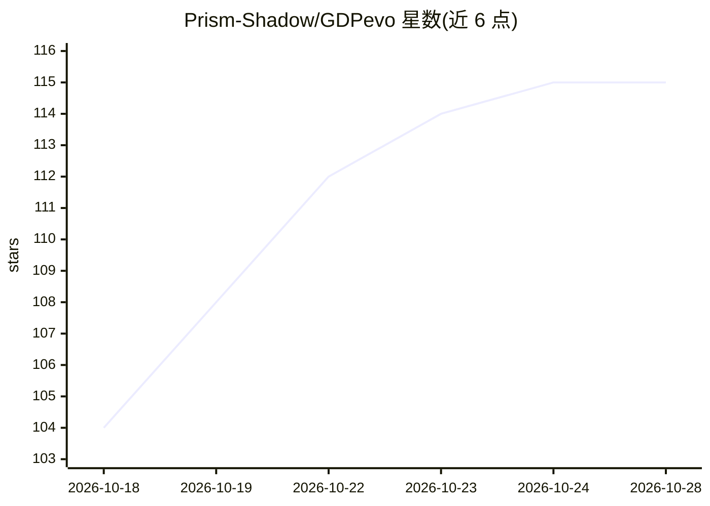

# Prism-Shadow/GDPevo

⭐ 117 · Python · Apache-2.0 · 推送 2026-09-16 · [GitHub](https://github.com/Prism-Shadow/GDPevo) · [官网](https://prism-shadow.github.io/GDPevo/) · 组织维护 · 中文 README

**评测 agent 自我进化能力的公开基准（240 个真实业务任务）**

面向 agent 自进化（self-evolution）研究的公开基准：发布 240 个任务、分 24 个任务组，覆盖 CRM、ERP、金融、医疗、法律、数据分析与工程运维；每组含共享业务环境、5 个训练任务与 5 个保留测试任务。提供 base/self/fewshot/reflect-3 四种评测模式的结果，指标包括准确率、轮次、工具调用与成本；仓库还含数据构建三阶段工作区与评分工作区，构建流程面向 Codex 工作流编写，其他 agent 框架需少量适配。

## 筛选速览

| 维度 | 判定 | 备注 |
|---|---|---|
| AI 角色 | `ai-knowledge` | 知识聚合/清单类 |
| 许可风险 | `permissive` | Apache-2.0 |
| 部署形态 | `None` |  |
| 模型依赖 | — | README 未给出锁定关系 |
| 硬件要求 | — | 无带数字的原话,不猜 |
| 安装摩擦 | `low` | 无编译、无系统依赖或容器化 |
| 成熟度 | — | 结构信号不足 |

## 能力要点

- 240 个任务、24 个任务组，覆盖 CRM/ERP/金融/医疗/法律等领域
- base/self/fewshot/reflect-3 四种评测模式与成本/轮次/工具调用指标
- 三阶段数据构建工作区（场景发现/任务组合成/质量过滤）与可复用评分工作区
- 附论文引用与中英双语说明

## 适用场景

- 研究者评测 agent 在业务任务上的自我进化能力
- 对比不同 harness 与模型在自进化模式下的表现
- 复用数据构建流程生成新的任务组

## 场景标签

`模型评测` · 领域:评测与运维

## 证据(README 行号)

> L8: **GDPevo** is a public benchmark for evaluating agent self-evolution on real business work. The data release contain
> L48: |`data/`|Released benchmark data, including task groups, shared environments, train/test tasks, reference answers, 

## 星数曲线

2026-10-18 104 → 2026-10-28 115（+11）

---
*卡片 v1 · prompt 1.4 · 生成 2026-10-23 · 置信度 high · 依据 README sha `0b180aa8312c` · [字段定义](../../DATASET.md)*
