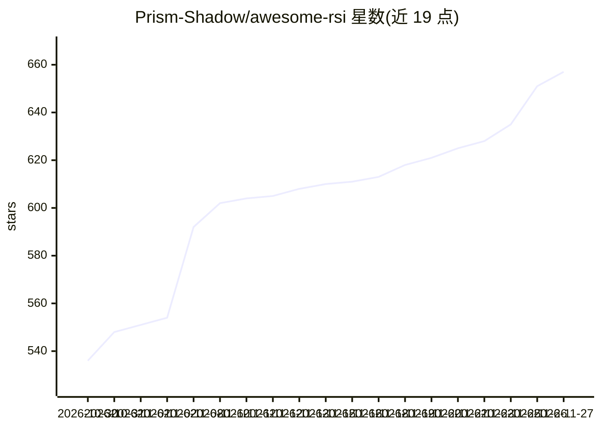

# Prism-Shadow/awesome-rsi

⭐ 657 · JavaScript · 推送 2026-11-26 · [GitHub](https://github.com/Prism-Shadow/awesome-rsi) · [官网](https://prism-shadow.github.io/awesome-rsi/) · 组织维护

**面向研究者的递归自我改进（RSI）论文索引清单**

收集递归自我改进（Recursive Self-Improvement）领域的基准、方法与系统论文清单，按 RSI artifact（模型参数、Harness 代码、上下文、记忆、技能等）维度组织方法与系统条目，按 RSI mode 组织基准条目。收录 148 篇方法论文、34 篇基准论文与 3 个系统，提供英文和中文的入门图解指南、分类综述、引用图谱，并配套网站支持多维度筛选浏览。条目标注发表会议与项目链接。

## 筛选速览

| 维度 | 判定 | 备注 |
|---|---|---|
| AI 角色 | `ai-knowledge` | 知识聚合/清单类 |
| 许可风险 | `none` | — |
| 部署形态 | `None` |  |
| 模型依赖 | — | README 未给出锁定关系 |
| 硬件要求 | — | 无带数字的原话,不猜 |
| 安装摩擦 | `low` | 无编译、无系统依赖或容器化 |
| 成熟度 | — | 结构信号不足 |

## 能力要点

- 收录 148 篇方法论文、34 篇基准论文与 3 个系统
- 九维分类法组织 RSI 方法，并附传统深度学习视角的启发
- 提供英文与中文双语入门图解指南与 1 分钟视频走读
- 配套网站支持多维度筛选与引用图谱浏览

## 适用场景

- 查找递归自我改进方向可借鉴的方法论文
- 为自我进化 agent 研究选择合适的评测基准
- 通过分类综述寻找新的研究切入点

## 场景标签

`精选清单` `科研工具` · 领域:学习与行业

## 证据(README 行号)

> L13: ## Our survey
> L29: Awesome RSI collects **benchmarks, methods, and systems for Recursive Self-Improvement**. We follow the loop: an ag
> L31: **148 method papers · 34 benchmark papers · 3 systems**

## 星数曲线

2026-10-30 536 → 2026-11-27 657（+121）

---
*卡片 v1 · prompt 1.4 · 生成 2026-11-26 · 置信度 high · 依据 README sha `50194d1ba1a3` · [字段定义](../../DATASET.md)*
