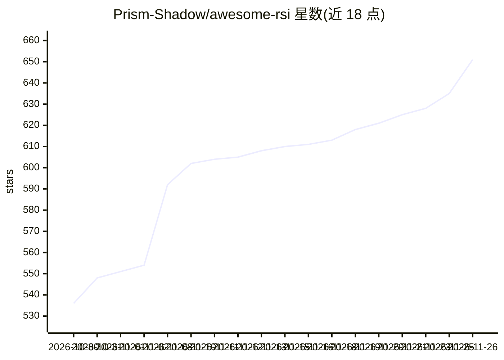

# Prism-Shadow/awesome-rsi

⭐ 651 · JavaScript · 推送 2026-11-24 · [GitHub](https://github.com/Prism-Shadow/awesome-rsi) · [官网](https://prism-shadow.github.io/awesome-rsi/) · 组织维护

**递归自我改进（RSI）论文策展索引，146 方法+34 基准**

 Awesome RSI 收集递归自我改进领域的基准、方法与系统论文，按自定的九维度分类组织：方法与系统按被改进的 RSI 工件（模型参数、harness 代码、上下文、记忆、技能）分组，基准按在线/离线/混合协议组织。README 提供 146 篇方法论文、34 篇基准论文与 3 个系统的清单，并配套网站支持按多维过滤比较、引用图浏览，另附作者的 RSI 综述与图解入门指南（含中文版）。

## 筛选速览

| 维度 | 判定 | 备注 |
|---|---|---|
| AI 角色 | `ai-knowledge` | 知识聚合/清单类 |
| 许可风险 | `none` | — |
| 部署形态 | `None` |  |
| 模型依赖 | — | README 未给出锁定关系 |
| 硬件要求 | — | 无带数字的原话,不猜 |
| 安装摩擦 | `low` | 无编译、无系统依赖或容器化 |
| 成熟度 | — | 结构信号不足 |

## 能力要点

- 收录 146 篇方法论文、34 篇基准论文、3 个系统
- 按 RSI 工件维度组织：模型参数/harness 代码/上下文/记忆/技能
- 配套网站支持多维度过滤与引用图浏览
- 附作者综述及中英双语图解入门指南

## 适用场景

- 查找可基于其构建的 RSI 方法论文
- 挑选衡量自我改进效果的基准
- 通过引用图梳理论文间的关联脉络

## 场景标签

`精选清单` · 领域:学习与行业

## 证据(README 行号)

> L29: Awesome RSI collects **benchmarks, methods, and systems for Recursive Self-Improvement**. We follow the loop: an ag
> L31: **146 method papers · 34 benchmark papers · 3 systems**
> L44: **What does the agent improve?** The tree below follows the RSI artifact dimension.

## 星数曲线

2026-10-30 536 → 2026-11-26 651（+115）

---
*卡片 v1 · prompt 1.4 · 生成 2026-11-25 · 置信度 high · 依据 README sha `ca6336a5207c` · [字段定义](../../DATASET.md)*
